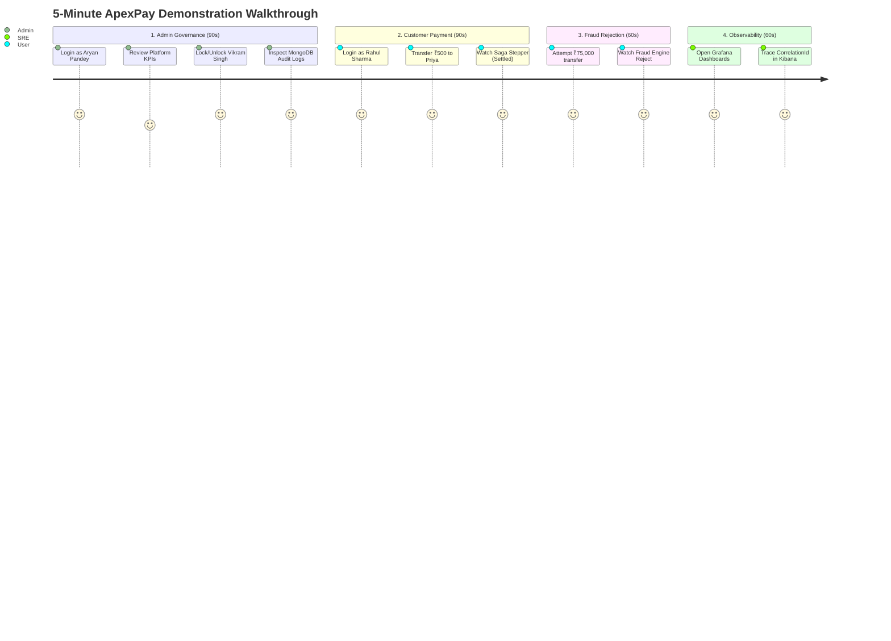

# ApexPay — 5-Minute Technical Demonstration Walkthrough

This document provides a guided 5-minute script for demonstrating the **ApexPay Event-Driven Payment Platform** during technical interviews, resume reviews, or team walkthroughs.

---

## Demo Credentials & Persona Matrix

| Persona | Role | Username | Password (from env) | Key Demo Capability |
|---|---|---|---|---|
| **Aryan Pandey** | `ADMIN` | `aryan.pandey` | `Admin@ApexPay2026!` | System-wide audit, user lock/unlock, platform KPIs, observability links |
| **Rahul Sharma** | `USER` | `rahul.sharma` | `User@ApexPay2026!` | Standard customer: 2 accounts (₹45,000 & ₹12,500), transfer money, live stepper |
| **Priya Nair** | `USER` | `priya.nair` | `User@ApexPay2026!` | Recipient customer: Account balance ₹85,000 |
| **Vikram Singh** | `USER` (LOCKED) | `vikram.singh` | `User@ApexPay2026!` | Demonstrates automatic security lockout and admin unlock flow |

> **Note**: Passwords are read dynamically from `.env` (`SEED_ADMIN_PASSWORD` and `SEED_USER_PASSWORD`) and are never hardcoded in source.

---

## 5-Minute Live Demo Script



---

### Part 1: Admin Governance & Security Control (0:00 - 1:30)

1. **Launch the Dashboard**:
   - Open your browser at `http://localhost:5173` (or local Ingress `http://localhost`).
2. **Login as Admin**:
   - Username: `aryan.pandey`
   - Password: `Admin@ApexPay2026!`
   - *Quick Persona Switcher*: Alternatively, click the **"Admin (Aryan Pandey)"** pill on the login screen.
3. **Inspect Admin Control Center**:
   - **System KPIs**: Point out the live telemetry cards: Total Transaction Volume, Settlement Success Rate (~80%), and Failure Reasons breakdown.
   - **User Security Table**:
     - Locate user **Vikram Singh** (`vikram.singh`). Note his status is `LOCKED`.
     - Click **Unlock User**. Notice the live status changes to `ACTIVE` via `PATCH /api/users/{id}/status`.
     - Click **Lock User** on another demo user to demonstrate instant authorization revocation.
   - **Observability Quick-Launch**:
     - Highlight the top navigation badges linking directly to **Grafana (3000)**, **Kibana (5601)**, and **SonarQube (9000)**.

---

### Part 2: Normal Customer Experience & Choreographed Saga (1:30 - 3:00)

1. **Switch Persona to Customer**:
   - Click **Logout** (or click the persona switcher pill for **"User (Rahul Sharma)"**).
   - Login with `rahul.sharma` / `User@ApexPay2026!`.
2. **Inspect User Account View**:
   - Notice Rahul only sees his **own accounts** (Account 1: ₹45,000.00, Account 2: ₹12,500.00). Strict RBAC prevents him from viewing other customers' balances or transactions.
3. **Execute an Instant Transfer**:
   - In the **Transfer Money** card:
     - **Source Account**: Select Rahul's Primary Checking (`...1101`)
     - **Target Account**: Enter Priya Nair's Account (`22222222-2222-2222-2222-222222222201`)
     - **Amount**: `500.00`
     - **Reference**: `Dinner bill split`
   - Click **Initiate Transfer**.
4. **Demonstrate Saga Lifecycle**:
   - A modal stepper displays real-time status progression:
     1. `INITIATED` (Idempotency key recorded, outbox event stored)
     2. `VALIDATED` (Fraud rule checks passed)
     3. `SETTLED` (Double-entry ledger debit & credit executed atomically)
   - Rahul's available balance instantly decrements to ₹44,500.00.

---

### Part 3: Fraud Engine Rejection (3:00 - 4:00)

1. **Attempt High-Value Transfer**:
   - Select Rahul's Primary Account.
   - Enter Amount: `75000.00` (exceeds system threshold ₹50,000.00).
   - Click **Initiate Transfer**.
2. **Observe Instant Rejection**:
   - The status stepper immediately shifts to `FAILED`.
   - Reason displayed: `EXCEEDS_MAX_AMOUNT_LIMIT`.
   - Point out that Rahul's balance remains untouched (zero dirty writes).

---

### Part 4: Live Observability & Distributed Tracing (4:00 - 5:00)

1. **Grafana Real-Time Dashboards (`http://localhost:3000`)**:
   - Login: `admin` / `admin`.
   - Open **ApexPay — Payments Business Operations**:
     - View `payments_initiated_total` and `payments_settled_total`.
     - Point out the `fraud_rejections_total` graph spiking with label `rule="EXCEEDS_MAX_AMOUNT_LIMIT"`.
     - Check `outbox_pending_events` (should be 0, confirming instant poller processing).
2. **Kibana Log Correlation (`http://localhost:5601`)**:
   - Open **Discover** -> Data view `apexpay-*`.
   - Search by the transfer's `correlationId` (e.g. `correlationId: "..."` or filter `level: "ERROR"`).
   - Point out how a single transaction can be traced sequentially across:
     - `api-gateway`
     - `payment-service`
     - `fraud-service`
     - `account-service`
     - `notification-service`
   - Emphasize that all passwords, tokens, and account numbers are sanitized (`****-1101`) with zero credential leaks.

---

## One-Liner PowerShell Verification Commands

```powershell
# 1. Run automated cluster smoke test
.\scripts\smoke-test.ps1

# 2. Run all unit and integration tests across 8 modules
.\scripts\test.ps1

# 3. Run SonarQube quality gate scan
.\scripts\scan.ps1
```
