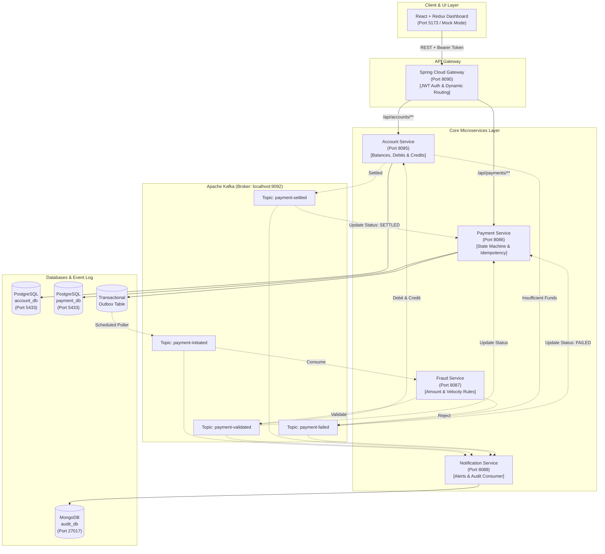

# Payment Platform (Java)

[](https://github.com/aryanpandeyce/payment-platform-java/actions/workflows/ci.yml)
[](https://www.oracle.com/java/technologies/downloads/#java21)
[](https://spring.io/projects/spring-boot)
[](https://kafka.apache.org/)
[](https://www.postgresql.org/)
[](https://www.mongodb.com/)
[](https://react.dev/)

A resilient, event-driven banking transaction and payment processing microservices platform built for global payment operations. Designed to demonstrate enterprise patterns including **Choreographed Saga**, **Transactional Outbox**, **Idempotent APIs**, and **Append-Only Auditing**.

---

## 🏛️ System Architecture



---

## 🚀 Port & Service Registry

| Service | Port (Host) | Technology | Responsibility | Storage |
| :--- | :---: | :--- | :--- | :--- |
| **API Gateway** | `8090` | Spring Cloud Gateway | Routing, JWT validation, `/auth/login` | Stateless |
| **Account Service** | `8085` | Spring Boot 3 + JPA | Account management, atomic debit & credit, settlement | PostgreSQL (`account_db`) |
| **Payment Service** | `8086` | Spring Boot 3 + JPA | Idempotent transfer initiation, status state machine | PostgreSQL (`payment_db`) |
| **Fraud Service** | `8087` | Spring Boot 3 + Kafka | High-value limit checks (₹50k), velocity rate checks | In-Memory / Distributed |
| **Notification Service** | `8088` | Spring Boot 3 + Mongo | Mock SMS/Email dispatch, append-only event auditing | MongoDB (`audit_db`) |
| **Frontend Dashboard** | `5173` | React 19 + Redux Toolkit | Transaction list, transfer form, live status polling | LocalStorage / Mock |
| **PostgreSQL** | `5433` | PostgreSQL 16 | Relational persistence for accounts, payments & outbox | Host mapped |
| **Apache Kafka** | `9092` | Apache Kafka (KRaft) | Event backbone for asynchronous microservices choreography | Event Log |
| **MongoDB** | `27017` | MongoDB 7.0 | Append-only document store for regulatory audit events | NoSQL |

---

## 💡 Key Architectural Patterns

1. **Transactional Outbox Pattern**:
   - Ensures atomicity between payment persistence and Kafka event emission.
   - Payments and event payloads are committed to PostgreSQL in the exact same database transaction.
   - A dedicated `@Scheduled` background worker safely polls unpublished events and dispatches them to Kafka, guaranteeing *at-least-once* delivery without two-phase commit overhead.
2. **Strict Idempotency (`Idempotency-Key`)**:
   - Every payment initiation requires a unique `Idempotency-Key` header.
   - Enforced at the database level with a `UNIQUE` constraint on `idempotency_key`.
   - Re-submitting identical transfer payloads returns the cached transaction, shielding the customer from double-debits during mobile network timeouts.
   - Submitting an altered request body with an existing key returns an immediate `409 Conflict`.
3. **Choreographed Saga with Compensation**:
   - Asynchronous settlement across independent bounded contexts (`account-service` and `payment-service`) without a central coordinator bottleneck.
   - If a credit operation fails after a successful debit, an automated compensation transaction reverses the debit atomically.
4. **Finite State Machine Lifecycle**:
   - Terminal status isolation: Transitions are strictly constrained (`INITIATED` $\rightarrow$ `VALIDATED` $\rightarrow$ `SETTLED` or `FAILED`).
   - Terminal states (`SETTLED` / `FAILED`) are immutable and cannot be overwritten.
5. **Regulatory Append-Only Audit Logging**:
   - The Notification Service consumes all Kafka lifecycle topics (`payment-initiated`, `payment-validated`, `payment-settled`, `payment-failed`) and logs timestamped events directly into MongoDB for audit compliance.

---

## 🛠️ Quickstart: Running with Docker Compose

To start the complete infrastructure and all 6 services with a single command:

```bash
docker compose up --build -d
```

Check the health and running status of all containers:

```bash
docker compose ps
```

Access the user interface:
- **Web Dashboard**: [http://localhost:5173](http://localhost:5173) (Demo credentials: `user1` / `password123`)
- **API Gateway**: [http://localhost:8090](http://localhost:8090)

---

## 💻 Running Services Locally

You can launch all infrastructure and microservices with our helper script:

```powershell
.\run-local.ps1
```

Or manually:
```powershell
# 1. Start core infrastructure containers (Postgres, Kafka, Mongo)
docker compose up -d postgres kafka mongodb

# 2. Set user timezone for Postgres compatibility
$env:JAVA_TOOL_OPTIONS = "-Duser.timezone=Asia/Kolkata"

# 3. Launch microservices in separate terminals
cd account-service;       .\mvnw.cmd spring-boot:run
cd payment-service;       .\mvnw.cmd spring-boot:run
cd fraud-service;         .\mvnw.cmd spring-boot:run
cd notification-service;  .\mvnw.cmd spring-boot:run
cd api-gateway;           .\mvnw.cmd spring-boot:run

# 4. Launch React Frontend
cd frontend;              npm install; npm run dev
```

---

## ⚡ 2-Minute PowerShell Demo

Run this rapid verification flow in PowerShell:

```powershell
# 1. Obtain JWT from API Gateway
$loginBody = @{ username = "user1"; password = "password123" } | ConvertTo-Json
$token = (Invoke-RestMethod -Uri "http://localhost:8090/auth/login" -Method Post -Body $loginBody -ContentType "application/json").token
$headers = @{ "Authorization" = "Bearer $token" }

# 2. Create Rahul's Account (₹10,000) & Priya's Account (₹5,000)
$rahul = Invoke-RestMethod -Uri "http://localhost:8090/api/accounts" -Method Post -Headers $headers -Body (@{ ownerName = "Rahul Sharma"; initialBalance = 10000.00; currency = "INR" } | ConvertTo-Json) -ContentType "application/json"
$priya = Invoke-RestMethod -Uri "http://localhost:8090/api/accounts" -Method Post -Headers $headers -Body (@{ ownerName = "Priya Patel"; initialBalance = 5000.00; currency = "INR" } | ConvertTo-Json) -ContentType "application/json"

# 3. Execute Transfer (Rahul -> Priya: ₹500)
$key = [System.Guid]::NewGuid().ToString()
$payHeaders = @{ "Authorization" = "Bearer $token"; "Idempotency-Key" = $key }
$payBody = @{ senderAccountId = $rahul.id; receiverAccountId = $priya.id; amount = 500.00; currency = "INR" } | ConvertTo-Json
$payment = Invoke-RestMethod -Uri "http://localhost:8090/api/payments" -Method Post -Headers $payHeaders -Body $payBody -ContentType "application/json"

# 4. Wait for Kafka Settlement & Check Status
Start-Sleep -Seconds 2
Invoke-RestMethod -Uri "http://localhost:8090/api/payments/$($payment.id)" -Method Get -Headers $headers
```

For the complete interactive walkthrough including fraud breach testing and MongoDB audit checks, see [docs/DEMO.md](docs/DEMO.md).

---

## 🧪 Testing

Each microservice includes unit tests for domain business rules and integration/smoke tests using in-memory H2 databases:

```powershell
# Run tests across all services using the Maven wrapper:
.\mvnw.cmd test -B
```

---

## 🔍 Known Limitations & Production Enhancements

To keep this learning codebase transparent, fast, and easy to study, the following trade-offs were intentionally made:

1. **In-Memory Fraud Velocity Tracking**: The velocity check in `fraud-service` uses a local in-memory sliding window (`ConcurrentHashMap`). In a distributed multi-instance deployment, this should be backed by a distributed cache like Redis or Hazelcast.
2. **Simplified Saga Choreography**: Event flow uses choreography across Kafka topics. While highly decoupled, complex enterprise sagas spanning dozens of compensation branches often benefit from an orchestrator (e.g., Temporal or Camunda).
3. **Hardcoded Demo JWT Users**: Authentication in the API Gateway authenticates demo credentials configured via environment variables. In production, this would integrate with an OAuth2 / OIDC provider such as Keycloak, Okta, or AWS Cognito.
4. **Single Currency**: Currently restricted to INR transactions without currency conversion logic.