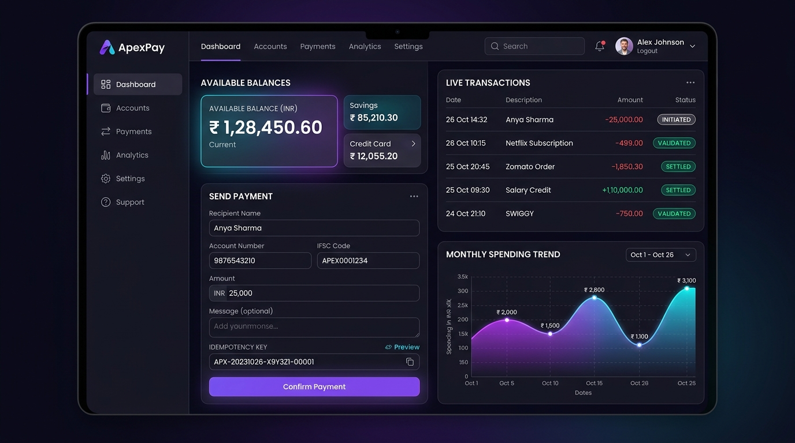
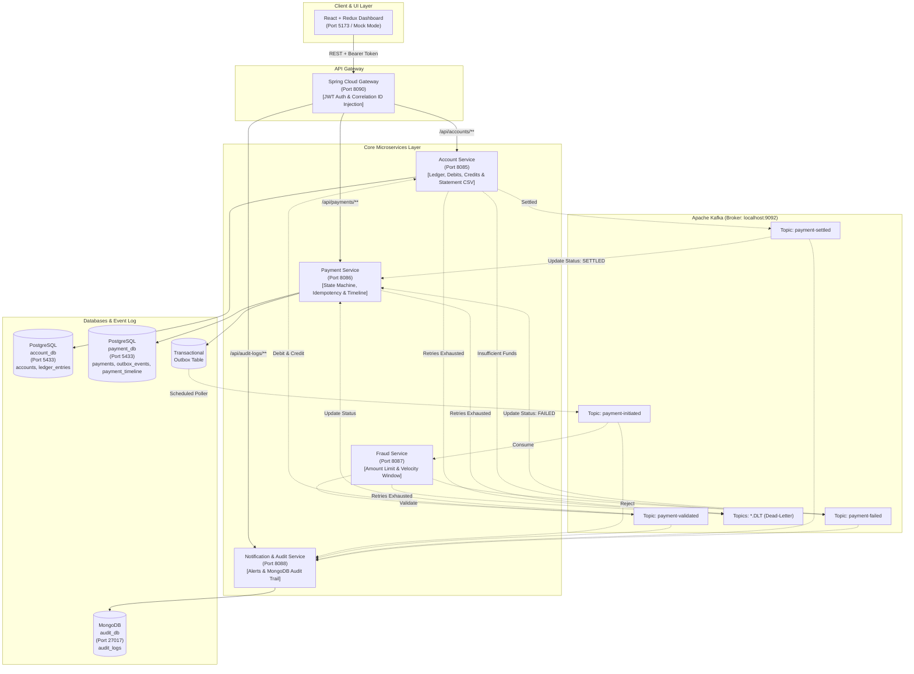

# Payment Platform (Java)

[](https://github.com/aryanpandeyce/payment-platform-java/actions/workflows/ci.yml)
[](LICENSE)
[](https://www.oracle.com/java/technologies/downloads/#java21)
[](https://spring.io/projects/spring-boot)
[](https://kafka.apache.org/)
[](https://www.postgresql.org/)
[](https://www.mongodb.com/)
[](https://react.dev/)

**Live GitHub Pages Demo**: [https://aryanpandeyce.github.io/payment-platform-java/](https://aryanpandeyce.github.io/payment-platform-java/)

A production-grade, event-driven banking transaction and payment processing microservices platform built for global payment operations. Designed to demonstrate enterprise distributed systems patterns: **Choreographed Saga**, **Transactional Outbox**, **Strict Idempotency Keys**, **Flyway Database Migrations**, **Dead-Letter Recovery (DLT)**, and **Append-Only Auditing**.

---

## 📸 User Interface Preview



The platform features a modern fintech interface with:
- **Available Balances Grid**: Instant ledger account balances in INR with one-click UUID copy and transaction ledger review.
- **Double-Click Protected Transfer Form**: Pre-flight review modal, account lookup, quick amount chips, and client-generated UUID `Idempotency-Key` preview.
- **Live Lifecycle Stepper**: Real-time status progression (`INITIATED` $\rightarrow$ `VALIDATED` $\rightarrow$ `SETTLED` or `FAILED`) tracking fraud validation and atomic ledger settlement.
- **Spending & Volume Analytics**: Interactive Recharts area chart summarizing real-time transaction velocity and total settled volume.
- **Dark & Light Mode**: Accessible design system with custom CSS tokens, keyboard navigation, and toast notifications.
- **Admin MongoDB Audit Trail**: Searchable event history with distributed correlation ID tracing (`X-Correlation-Id`).

---

## 🏛️ System Architecture



---

## 🚀 Port & Service Registry

| Service | Port (Host) | Technology | Swagger UI / Endpoint | Storage |
| :--- | :---: | :--- | :--- | :--- |
| **API Gateway** | `8090` | Spring Cloud Gateway | `/auth/login` | Stateless |
| **Account Service** | `8085` | Spring Boot 3 + JPA | `http://localhost:8085/swagger-ui.html` | PostgreSQL (`account_db`) |
| **Payment Service** | `8086` | Spring Boot 3 + JPA | `http://localhost:8086/swagger-ui.html` | PostgreSQL (`payment_db`) |
| **Fraud Service** | `8087` | Spring Boot 3 + Kafka | `http://localhost:8087/swagger-ui.html` | In-Memory / Distributed |
| **Notification Service** | `8088` | Spring Boot 3 + Mongo | `http://localhost:8088/swagger-ui.html` | MongoDB (`audit_db`) |
| **Frontend Dashboard** | `5173` | React 18 + Redux Toolkit | `http://localhost:5173` | LocalStorage / Mock |
| **PostgreSQL** | `5433` | PostgreSQL 16 Alpine | Database Engine | Host mapped |
| **Apache Kafka** | `9092` | Apache Kafka 3.8.1 (KRaft) | Event Stream Broker | Event Log |
| **MongoDB** | `27017` | MongoDB 7.0 | Document Store | NoSQL |

---

## 💡 Key Architectural Patterns

1. **Transactional Outbox Pattern**:
   - Commits payment state and the domain event payload in the exact same database transaction in PostgreSQL.
   - Background worker (`OutboxPoller`) polls unpublished events and publishes them to Kafka with zero dual-write inconsistencies.
2. **Strict Idempotency Keys**:
   - Enforced with database `UNIQUE` constraint on `idempotency_key`. Replays return cached responses immediately without secondary debits; modified payloads return `409 Conflict`.
3. **Choreographed Saga & Compensations**:
   - Decoupled event choreography without a central coordinator bottleneck.
   - Settlement listener executes atomic sender debit and receiver credit; if an account is missing or blocked, automated compensation refunds the funds and marks payment `FAILED`.
4. **Retry & Dead-Letter Topics (`DLT`)**:
   - Consumer message listeners are configured with `DeadLetterPublishingRecoverer` and `DefaultErrorHandler` (2 retries, 1-second backoff before routing to `<topic>.DLT`).
5. **Distributed Correlation Tracking**:
   - Every inbound request receives or generates `X-Correlation-Id`, which propagates across Spring Web filters, MDC logs, and Kafka record headers.
6. **Immutable Ledger Entries & Statement Export**:
   - Every debit, credit, opening deposit, and transfer writes an immutable row in `ledger_entries`, supporting CSV export on demand.
7. **Flyway Migrations**:
   - Version-controlled schema evolutions (`V1__...`, `V2__...`) replacing fragile `ddl-auto: update`.

---

## 🛠️ Quickstart: Running with Docker Compose

To launch the full ecosystem (all 5 microservices, Kafka, PostgreSQL, MongoDB, and React dashboard):

```bash
docker compose up --build -d
```

Verify that all 9 containers are running:

```bash
docker compose ps
```

Open your browser:
- **Web Dashboard**: [http://localhost:5173](http://localhost:5173) (Demo credentials: `admin` / `password`)
- **API Gateway**: [http://localhost:8090](http://localhost:8090)
- **Account Service Swagger**: [http://localhost:8085/swagger-ui.html](http://localhost:8085/swagger-ui.html)
- **Payment Service Swagger**: [http://localhost:8086/swagger-ui.html](http://localhost:8086/swagger-ui.html)

---

## 💻 Running Services Locally (PowerShell)

You can launch all infrastructure and microservices with our automated helper script:

```powershell
.\run-local.ps1
```

Or step-by-step:

```powershell
# 1. Start core infrastructure containers
docker compose up -d postgres kafka mongodb

# 2. Launch microservices in separate PowerShell terminals
cd account-service;       .\mvnw.cmd spring-boot:run
cd payment-service;       .\mvnw.cmd spring-boot:run
cd fraud-service;         .\mvnw.cmd spring-boot:run
cd notification-service;  .\mvnw.cmd spring-boot:run
cd api-gateway;           .\mvnw.cmd spring-boot:run

# 3. Launch React Frontend
cd frontend;              npm run dev
```

---

## 🧪 Testing

The repository features comprehensive test coverage across all layers:
- **Unit Tests**: Domain aggregates (`AccountTest`, `PaymentTest`), fraud rule engines (`FraudCheckServiceTest`), and JWT cryptographic signing (`JwtUtilTest`).
- **Integration Tests**: REST APIs, Bean Validation, status state machines, and H2 database persistence.
- **Testcontainers Tests**: Real PostgreSQL and Apache Kafka integration tests verifying payment idempotency and end-to-end event choreography (`PaymentIdempotencyTestcontainersTest`, `KafkaFlowTestcontainersTest`).

To run the complete test suite across all services:

```powershell
.\mvnw.cmd test -B
```

---

## 🤖 How This Was Built (Spec-Driven, AI-Assisted)

This project was built using **Spec-Driven Development (SDD)** with AI pair-programming assistance:
1. **Source of Truth First**: Every functional requirement, financial invariant rule, error code, and distributed boundary was strictly defined beforehand in [docs/SSD.md](docs/SSD.md) before writing implementation code.
2. **AI-Assisted Pair Programming**: Developed in collaboration with Google DeepMind's Antigravity AI coding assistant, adhering to strict architectural constraints (immutable Java records, DDD package boundaries, Flyway migrations, zero Lombok, no hardcoded secrets).
3. **Test-First Methodology**: Each domain capability was verified through automated tests prior to final phase integration.
4. **Architecture Decision Records**: Key distributed systems trade-offs are documented transparently in [docs/adr/](docs/adr/).

---

## 📄 License & Contributing

- Distributed under the [MIT License](LICENSE).
- Contribution guidelines and pull request instructions are detailed in [CONTRIBUTING.md](CONTRIBUTING.md).