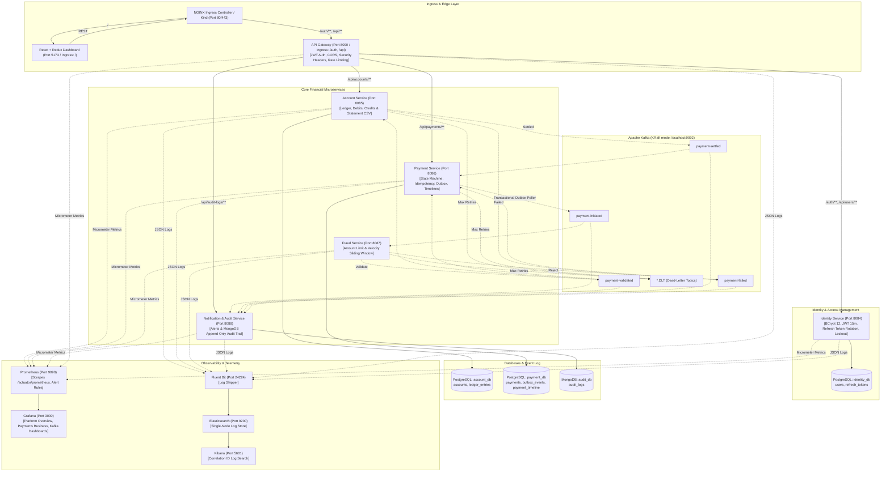

# Payment Platform (Java)

[](https://github.com/aryanpandeyce/payment-platform-java/actions/workflows/ci.yml)
[](.gitlab-ci.yml)
[](docs/devsecops.md)
[](LICENSE)
[](https://www.oracle.com/java/technologies/downloads/#java21)
[](https://spring.io/projects/spring-boot)
[](https://kafka.apache.org/)
[](https://www.postgresql.org/)
[](https://www.mongodb.com/)
[](https://react.dev/)

**Live GitHub Pages Demo**: [https://aryanpandeyce.github.io/payment-platform-java/](https://aryanpandeyce.github.io/payment-platform-java/)  
**Interactive 5-Minute Walkthrough**: [DEMO.md](DEMO.md) | **DevSecOps Guide**: [docs/devsecops.md](docs/devsecops.md)

A production-grade, event-driven banking transaction and payment processing microservices platform built for global payment operations. Designed to demonstrate enterprise distributed systems and DevSecOps patterns: **Choreographed Saga**, **Transactional Outbox**, **Strict Idempotency Keys**, **BCrypt Dual-Token Identity & RBAC**, **Flyway Database Migrations**, **Kubernetes Helm Umbrella Chart & OpenShift SCC Compliance**, **Full ELK & Prometheus/Grafana Observability**, and **Zero-Trust Network Governance**.

---

## 📸 User Interface Preview


The platform features a modern fintech interface with:
- **Role-Based Authentication**: Secure JWT login with refresh token rotation and in-memory access token storage (zero credentials in localStorage).
- **Admin Control Center**: System-wide transactions ledger, MongoDB audit trail, one-click user lock/unlock, platform KPIs, and direct links to Grafana, Kibana, and SonarQube.
- **Customer Banking View**: Available balances grid in INR with double-click protected transfer form, UUID idempotency preview, and live Saga timeline stepper.
- **Spending Analytics**: Interactive Recharts area chart summarizing real-time transaction velocity and total settled volume.
- **Persona Switcher**: One-click quick login for demo personas (Admin Aryan Pandey, User Rahul Sharma, Locked User Vikram Singh).

---

## 🏛️ System Architecture



---

## 🚀 Port & Service Registry

| Service / Component | Port (Host) | Technology | Path / Health / UI | Database / Storage |
| :--- | :---: | :--- | :--- | :--- |
| **Frontend Dashboard** | `5173` | React 18 + Vite | `http://localhost:5173` | Static Nginx / In-Memory Auth |
| **API Gateway** | `8090` | Spring Cloud Gateway | `http://localhost:8090/actuator/health` | Stateless (In-Memory Limiter) |
| **Identity Service** | `8084` | Spring Boot 3 + Security | `http://localhost:8084/swagger-ui.html` | PostgreSQL (`identity_db`) |
| **Account Service** | `8085` | Spring Boot 3 + JPA | `http://localhost:8085/swagger-ui.html` | PostgreSQL (`account_db`) |
| **Payment Service** | `8086` | Spring Boot 3 + JPA | `http://localhost:8086/swagger-ui.html` | PostgreSQL (`payment_db`) |
| **Fraud Service** | `8087` | Spring Boot 3 + Kafka | `http://localhost:8087/swagger-ui.html` | In-Memory Sliding Window |
| **Notification Service** | `8088` | Spring Boot 3 + Mongo | `http://localhost:8088/swagger-ui.html` | MongoDB (`audit_db`) |
| **PostgreSQL** | `5433:5432` | PostgreSQL 16.8 Alpine | Multi-database (`identity_db`, `account_db`, `payment_db`) | Docker Volume `pg_data` |
| **Apache Kafka** | `9092` | Apache Kafka 3.9.0 (KRaft) | Broker & KRaft Controller | Internal Event Log |
| **MongoDB** | `27017` | MongoDB 7.0.17 | Immutable Audit Store | Docker Volume `mongo_data` |
| **Prometheus** | `9090` | Prometheus v3.2.1 | `http://localhost:9090` | Time Series TSDB |
| **Grafana** | `3000` | Grafana 11.5.2 | `http://localhost:3000` (admin/admin) | Dashboards-as-Code |
| **Elasticsearch** | `9200` | Elasticsearch 8.17.3 | `http://localhost:9200` | Inverted Index Log Store |
| **Kibana** | `5601` | Kibana 8.17.3 | `http://localhost:5601` | Log Search & Analytics |
| **SonarQube** | `9000` | SonarQube Community 10.7 | `http://localhost:9000` (admin/admin) | Dedicated Postgres (Port 5434) |

---

## 🛡️ DevSecOps & Governance

Complete details on security pipelines, scanning, and Kubernetes orchestration are in [docs/devsecops.md](docs/devsecops.md).
- **Dual CI Pipelines**:
  - **GitLab CI** (`.gitlab-ci.yml`): 6-stage enterprise pipeline (`build` $\rightarrow$ `test` $\rightarrow$ `quality` $\rightarrow$ `package` $\rightarrow$ `security` $\rightarrow$ `deploy`) with Kaniko container builds and Trivy vulnerability auditing.
  - **GitHub Actions** (`.github/workflows/ci.yml`): Public multi-module build, Testcontainers integration testing, and automatic GitHub Pages deployment.
- **SonarQube Quality Gate**: Enforces $\ge 70\%$ coverage on new code, $0$ new bugs, $0$ vulnerabilities, and $\le 3\%$ duplication.
- **Trivy Vulnerability Auditing**: Automated SCA filesystem scan, container image vulnerability scanning, secret leak detection, and IaC Kubernetes misconfiguration checks.
- **Kubernetes & OpenShift Compliance**: Production Helm umbrella chart (`deploy/helm/payment-platform`) with zero-trust `NetworkPolicy`, read-only root filesystems, and strict OpenShift `restricted-v2` SCC compatibility.

---

## 🛠️ Quickstart: Running the Platform

### 1. Start with Docker Compose
We provide convenient PowerShell scripts in `scripts/`:

```powershell
# Start Core Microservices & Databases
.\scripts\up.ps1

# (Optional) Start with Observability (Prometheus, Grafana, ELK)
.\scripts\up.ps1 -WithObservability

# (Optional) Start with SonarQube Code Quality Stack
.\scripts\up.ps1 -WithQuality
```

Open your browser:
- **Fintech Dashboard**: [http://localhost:5173](http://localhost:5173) (Login as `aryan.pandey` / `Admin@ApexPay2026!` or `rahul.sharma` / `User@ApexPay2026!`)
- **API Gateway**: [http://localhost:8090](http://localhost:8090)
- **Grafana**: [http://localhost:3000](http://localhost:3000) (Credentials: `admin` / `admin`)
- **Kibana**: [http://localhost:5601](http://localhost:5601)

### 2. Run Automated Verification Scripts
```powershell
# Run all unit and integration tests across 8 Maven modules
.\scripts\test.ps1

# Run local SonarQube and Trivy security scans
.\scripts\scan.ps1

# Verify or inspect database seed data
.\scripts\demo-data.ps1
```

### 3. Deploy to Local Kubernetes (Kind)
```powershell
# 1. Spin up Kind cluster with Ingress-NGINX
.\scripts\kind-up.ps1

# 2. Deploy Helm umbrella chart
.\scripts\deploy.ps1

# 3. Run automated end-to-end smoke test
.\scripts\smoke-test.ps1

# 4. Teardown cluster when done
.\scripts\kind-down.ps1
```

---

## 🧪 Testing Architecture

The platform follows Test-Driven Development (TDD) across all layers:
- **Unit Tests**: Domain aggregates (`AccountTest`, `PaymentTest`, `PasswordPolicyTest`), fraud rule engines (`FraudCheckServiceTest`), and sensitive data masking guards (`DataMaskingUtilTest`).
- **Integration Tests**: Gateway security filters (`JwtAuthenticationFilterTest`, `LoginRateLimiterFilterTest`, `SecurityHeadersGatewayTest`) and RBAC authorization (`AccountRbacIntegrationTest`, `PaymentRbacIntegrationTest`).
- **Testcontainers Integration Tests**: Real PostgreSQL constraints, Flyway schema migrations, and Kafka event choreography (`PaymentIdempotencyTestcontainersTest`, `KafkaFlowTestcontainersTest`).

To execute the multi-module test suite from the root:
```powershell
.\mvnw.cmd clean test -B
```

---

## 📄 License & Contributing
- Distributed under the [MIT License](LICENSE).
- Contribution guidelines are detailed in [CONTRIBUTING.md](CONTRIBUTING.md).