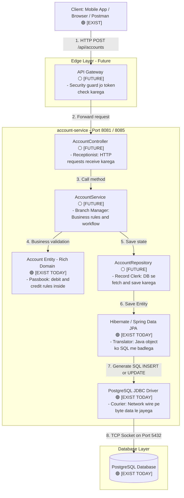
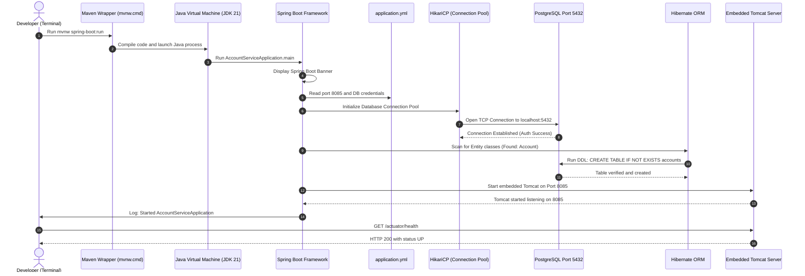
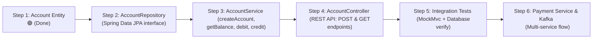

# Learning Guide: Account Service (Beginner to Pro)
> **Target Audience**: Kisi bhi aise person ke liye jisne pehle kabhi Java backend ya microservices nahi dekha hai.  
> **Language**: Simple Hinglish (Hindi written in English) with real-life analogies.

---

## PART 1 - Big Picture Flow Chart

Backend me jab koi user mobile app ya browser se button click karta hai, toh request backend ke andar ek step-by-step journey karti hai. Neeche ka diagram dikhata hai ki ek request kaise travel karti hai:



### Real-Life Analogy (SBI Bank Branch)
1. **Client (Postman/Browser)** = **Customer**: Jo counter pe form le kar aaya hai ("Mera account kholo").
2. **API Gateway (Future)** = **Bank Gate ka Security Guard**: Jo identity card check karega ki andar aane ki permission hai ya nahi.
3. **Controller (Future)** = **Receptionist / Token Counter**: Customer ka form pakadta hai, check karta hai phone number likha hai ya nahi, aur sahi cabin me bhejta hai.
4. **Service (Future)** = **Bank Branch Manager**: Jo decision leta hai ki transaction allow karni hai ya nahi.
5. **Account Entity (Aaj banaya)** = **Customer ki Passbook**: Jiske paas uska balance likha hai aur jisme direct rule hai ki bina balance ke debit nahi ho sakta.
6. **Repository (Future)** = **Record Room ka Clerk**: Jo almari se file nikaal kar manager ko deta hai.
7. **Hibernate (JPA)** = **Translator**: Manager English me bolta hai, par almari ke register me Sanskrit/SQL me likhna hota hai. Hibernate Java ko SQL query me translate karta hai.
8. **JDBC Driver** = **Chaprasi / Courier**: Jo physically chalkar server se database tak wire pe data deliver karta hai.
9. **PostgreSQL** = **Bank ki Main Tijori (Locker)**: Jahan par data hard disk me permanently save hota hai (computer band hone par bhi safe).

---

## PART 2 - Tech Stack: Kaun Kya Karta Hai?

| Technology | Kya karta hai? (1 line) | Real-Life Analogy | Ye hamare project me kahan dikhta hai? |
| :--- | :--- | :--- | :--- |
| **Java 21** | Core programming language jisme hum saara code likhte hain. | **English Language**: Jisme hum application ke instructions likhte hain. | Har `.java` file me (`Account.java`, `AccountTest.java`). |
| **Maven (mvnw)** | Dependencies download karta hai aur code compile/test karta hai. | **Delivery Partner + Construction Supervisor**: Saara samaan laata hai aur ghar banwata hai. | `pom.xml`, `mvnw.cmd` wrapper script. |
| **Spring Boot 3.x** | Readymade production framework jo Tomcat server aur configuration khud setup karta hai. | **Ready-to-Move Furnished Flat**: Jahan bijli, paani, furniture pehle se laga milta hai. | `pom.xml` me `<parent>`, `@SpringBootApplication`. |
| **Spring Web** | REST APIs banane ke liye controllers aur HTTP handling provide karta hai. | **Restaurant ka Order Counter**: Jo client ki HTTP GET/POST requests sunta hai. | `pom.xml` me `spring-boot-starter-web`. |
| **Spring Data JPA** | Database queries chalane ke liye boilerplate code khatam karta hai (e.g. `save()`, `findById()`). | **Smart Assistant**: Jisko sirf bolo "file save kar do", wo bina bole khud register me likh deta hai. | `pom.xml` me `spring-boot-starter-data-jpa`. |
| **Hibernate** | Java class (Object) aur Database Table (Relational DB) ke beech translation karta hai (ORM). | **Do-bhashiya (Translator)**: Jo Java ki bhasha ko SQL database ki bhasha me convert karta hai. | `Account.java` me `@Entity`, `@Table`, `@Id`. |
| **PostgreSQL Driver** | Java app aur PostgreSQL database ke beech physical network connection banata hai. | **Telephone Wire**: Jo hamare app aur database server ko aapas me connect karti hai. | `pom.xml` me `org.postgresql:postgresql`. |
| **Actuator** | Application ki health aur metrics check karne ke liye live endpoints deta hai (`/health`). | **Doctor ka Stethoscope / Dashboard Meter**: Jo batata hai app chal raha hai ya bimaar hai. | `http://localhost:8085/actuator/health`. |
| **JUnit 5** | Automated tests likhne aur run karne ka testing framework hai. | **Quality Control Inspector**: Jo har product banne ke baad check karta hai ki rules sahi hain ya nahi. | `AccountTest.java` me `@Test`. |

### Crucial Difference: Spring vs JPA vs Hibernate vs Spring Data JPA

Beginners hamesha in charo me confuse hote hain. Inka difference ekdam simple hai:

```
[ Your Code ]
      ↓
[ Spring Data JPA ]  --> Smart Wrapper: Aapko repository interface deta hai (save, findById)
      ↓
[ JPA (Jakarta) ]    --> Standard Rulebook / Interface: Sirf rules define karta hai (@Entity, @Id kya hoga)
      ↓
[ Hibernate ]        --> Worker Engine: JPA ke rules ko actually implement karta hai aur SQL banata hai
      ↓
[ JDBC Driver ]      --> Network Courier: SQL query ko wire par database tak bhejta hai
      ↓
[ PostgreSQL DB ]    --> Permanent Storage: Hard disk pe data table me store karta hai
```

- **JPA (Rulebook)**: Jaise Government ka Constitution. Ye sirf batata hai ki `@Entity` kya hai, par khud koi table nahi banata.
- **Hibernate (Worker)**: Jaise Police ya Officer jo us Constitution ke rules ko zameen pe execute karta hai. Hibernate SQL generate karta hai.
- **Spring Data JPA (Smart Assistant)**: Hibernate ko use karna aur aasan banane ke liye ek layer, taaki aapko SQL ya Hibernate ke complex session methods na likhne padein.

---

## PART 3 - Folder Structure Walkthrough

Humare `account-service/` ka folder tree aur har file ka purpose:

```text
account-service/
├── .mvn/wrapper/                  --> Maven wrapper ke jar aur properties (bina installed Maven ke run karne ke liye)
├── mvnw & mvnw.cmd                --> Windows (.cmd) aur Mac/Linux shell script jo build run karti hai
├── pom.xml                        --> Project Object Model: Sabhi libraries aur Java version ki master list
├── src/
│   ├── main/
│   │   ├── java/com/payments/account/
│   │   │   ├── AccountServiceApplication.java  --> Main entry point (@SpringBootApplication)
│   │   │   └── domain/
│   │   │       ├── Account.java                --> Core Entity: balance, owner, debit(), credit() rules
│   │   │       ├── InsufficientFundsException.java --> Custom error jab balance kam ho
│   │   │       └── InvalidAmountException.java     --> Custom error jab amount <= 0 ho
│   │   └── resources/
│   │       └── application.yml                 --> Port, Database URL, username, password ki settings
│   └── test/
│       └── java/com/payments/account/
│           ├── AccountServiceApplicationTests.java --> Spring Context load hone ka smoke test
│           └── domain/
│               └── AccountTest.java            --> Core business rules ka FAST unit test (No DB, No Spring)
```

### Ye files KAB run hoti hain?
1. **`pom.xml`, `mvnw.cmd`**: **Build Time par** (Jab code compile aur test hota hai).
2. **`AccountServiceApplication.java`, `application.yml`**: **App Start Time par** (Jab aap `./mvnw.cmd spring-boot:run` chalate ho).
3. **`Account.java`, `InsufficientFundsException.java`**: **Request Time par** (Jab koi user actual transaction karega).
4. **`AccountTest.java`**: **Sirf Testing Time par** (Development ke waqt safety ensure karne ke liye).

---

## PART 4 - How the App Starts (Sequence Diagram)

Jab aap terminal me `.\mvnw.cmd spring-boot:run` likhte hain, toh background me kya-kya hota hai:



---

## PART 5 - Database Connection, Step by Step

Humare `application.yml` me ye lines hain:
```yaml
server:
  port: ${SERVER_PORT:8081}

spring:
  datasource:
    url: jdbc:postgresql://localhost:5432/account_db
    username: ${DB_USERNAME:postgres}
    password: ${DB_PASSWORD}
  jpa:
    hibernate:
      ddl-auto: update
```

### Ye kaise kaam karta hai?
1. **`jdbc:postgresql://localhost:5432/account_db`**:
   - `jdbc:postgresql://`: Protocol jo driver ko batata hai ki ye Postgres DB hai.
   - `localhost:5432`: Aapka apna computer aur uska standard Postgres port 5432.
   - `account_db`: Database ka naam jiske andar hamari `accounts` table banegi.
2. **`${DB_USERNAME:postgres}`**:
   - Iska matlab: Agar terminal me `DB_USERNAME` set hai toh wo use karo, warna default `postgres` use karo.
3. **`${DB_PASSWORD}`**:
   - Iske aage koi default value nahi hai. Matlab terminal se password aana zaroori hai (security best practice).
4. **`ddl-auto: update`**:
   - DDL ka matlab: *Data Definition Language* (`CREATE TABLE`, `ALTER TABLE`).
   - `update` ka matlab: Hibernate application start hote hi database me check karega: *"Kya `accounts` table hai?"*. Agar nahi hai, toh wo automatically table create kar dega!
5. **Table Kahan Banti Hai?**:
   - Hard disk par `account_db` database ke andar `accounts` naam ki permanent physical table banti hai.

---

## PART 6 - Line-by-Line Walkthrough: Account.java

Hamara domain entity `Account.java` pure project ka sabse important file hai.

```java
package com.payments.account.domain;

import jakarta.persistence.Column;
import jakarta.persistence.Entity;
import jakarta.persistence.Id;
import jakarta.persistence.Table;
import jakarta.persistence.Version;
import java.math.BigDecimal;
import java.math.RoundingMode;
import java.time.Instant;
import java.util.UUID;
```
- **`import jakarta.persistence.*`**: JPA standard annotations jo batate hain ki ye class database se jude gi.
- **`import java.math.BigDecimal`**: Banking me paise handle karne ke liye (fractions aur rounding errors se bachata hai).
- **`import java.util.UUID`**: Globally Unique Identifier (e.g. `550e8400-e29b-41d4-a716-446655440000`).

```java
@Entity
@Table(name = "accounts")
public class Account {
```
- **`@Entity`**: Hibernate ko bolta hai: *"Is Java class ko database ki table treat karo."*
  - *Analogy*: Kisi regular kagaz pe bank ki official stamp lagana taaki wo official document ban jaye.
- **`@Table(name = "accounts")`**: Table ka naam explicitly `accounts` rakha kyunki `account` keyword kuch databases me reserved word hota hai.

```java
    @Id
    @Column(name = "id", nullable = false, updatable = false)
    private UUID id;
```
- **`@Id`**: Table ki Primary Key.
  - *Analogy*: Aapka Unique Bank Account Number ya Aadhaar Number.
- **`updatable = false`**: Ek baar account ban gaya toh uski ID kabhi change nahi ho sakti.

```java
    @Column(name = "owner_name", nullable = false)
    private String ownerName;

    @Column(name = "balance", nullable = false, precision = 19, scale = 2)
    private BigDecimal balance;
```
- **`precision = 19, scale = 2`**: Maximum 19 digits aur point ke baad exact 2 decimal places (e.g., `10500.50`). Float ya double kabhi use nahi karte kyunki `0.1 + 0.2 = 0.30000000000000004` ban jata hai, jo banking me fraud ya loss maana jata hai.

```java
    @Version
    private Long version;
```
- **`@Version` (Optimistic Locking)**:
  - *Analogy*: Tatkal train ticket counter. Agar 2 log ek sath same seat book karne aate hain, dono ke pass token #1 hota hai. Jo pehle submit karega uska counter #2 ho jayega. Doosre ka submit fail ho jayega kyunki uska version purana ho chuka hai. Isse race conditions aur double spending prevent hoti hai.

```java
    @Column(name = "created_at", nullable = false, updatable = false)
    private Instant createdAt;
```
- **`created_at`**: Timestamp (UTC me) jab ye account create hua tha.

```java
    protected Account() {
    }
```
- **`protected Account()`**: Hibernate ko reflection ke zariye database se data la kar object bharne ke liye ek empty constructor chahiye hota hai. Isko `protected` rakha taaki bahar ka koi dev bina naam aur balance ke empty account na bana sake.

```java
    public Account(String ownerName, BigDecimal initialBalance) {
        if (ownerName == null || ownerName.trim().isEmpty()) {
            throw new IllegalArgumentException("Owner name cannot be empty");
        }
        if (initialBalance == null || initialBalance.compareTo(BigDecimal.ZERO) < 0) {
            throw new InvalidAmountException("Initial balance cannot be negative or null");
        }

        this.id = UUID.randomUUID();
        this.ownerName = ownerName.trim();
        this.balance = initialBalance.setScale(2, RoundingMode.HALF_EVEN);
        this.createdAt = Instant.now();
    }
```
- **Constructor Rules**:
  - Khali owner name allow nahi hoga.
  - Negative initial balance allow nahi hoga.
  - ID automatically generate hogi.

```java
    public void debit(BigDecimal amount) {
        if (amount == null || amount.compareTo(BigDecimal.ZERO) <= 0) {
            throw new InvalidAmountException("Debit amount must be strictly greater than zero");
        }
        if (this.balance.compareTo(amount) < 0) {
            throw new InsufficientFundsException("Insufficient funds. Available balance: " + this.balance);
        }
        this.balance = this.balance.subtract(amount);
    }
```
- **`debit()` method**:
  - Agar amount 0 ya negative ho -> Exception throw.
  - Agar balance se zyada nikalne ki koshish ho -> Exception throw.
  - Balance safely subtract hoga.

```java
    public void credit(BigDecimal amount) {
        if (amount == null || amount.compareTo(BigDecimal.ZERO) <= 0) {
            throw new InvalidAmountException("Credit amount must be strictly greater than zero");
        }
        this.balance = this.balance.add(amount);
    }
```
- **`credit()` method**:
  - Valid amount add karega.

### Generated SQL Table (Jo Hibernate ne PostgreSQL me banayi)
```sql
CREATE TABLE accounts (
    id UUID NOT NULL,
    owner_name VARCHAR(255) NOT NULL,
    balance NUMERIC(19, 2) NOT NULL,
    version BIGINT,
    created_at TIMESTAMP(6) WITH TIME ZONE NOT NULL,
    PRIMARY KEY (id)
);
```

---

## PART 7 - AccountTest.java Walkthrough (TDD)

Humne code likhne se pehle unit test likha. Ye tests **0.2 seconds** me run hote hain kyunki inko na Spring chahiye na Database.

| Test Case | Plain English Explanation | Given (Input) | When (Action) | Then (Expectation) |
| :--- | :--- | :--- | :--- | :--- |
| **Test 1**: `shouldCreateAccountWithInitialBalance` | Naya account sahi initial balance ke sath banta hai ya nahi. | Name: "Aryan Pandey", Balance: 1000.00 | Account create kiya | ID non-null ho, balance 1000.00 ho, createdAt set ho. |
| **Test 2**: `shouldDebitAmountSuccessfully` | Normal debit hone par balance kam hota hai ya nahi. | Account balance: 1000.00 | `account.debit(400.00)` | Balance exact 600.00 bacha hona chahiye. |
| **Test 3**: `shouldThrowExceptionWhenDebitingMoreThanBalance` | Balance se zyada nikalne par error aana chahiye aur balance safe rehna chahiye. | Account balance: 1000.00 | `account.debit(1500.00)` | `InsufficientFundsException` aana chahiye aur balance 1000.00 hi rehna chahiye. |
| **Test 4**: `shouldThrowExceptionWhenDebitingZeroOrNegative` | 0 ya negative paise nikalne se rokna. | Account balance: 1000.00 | `debit(0)` ya `debit(-50)` | `InvalidAmountException` throw hona chahiye. |
| **Test 5**: `shouldCreditAmountSuccessfully` | Normal credit hone par balance badhta hai ya nahi. | Account balance: 500.00 | `account.credit(400.00)` | Balance 900.00 hona chahiye. |
| **Test 6**: `shouldThrowExceptionWhenCreditingZeroOrNegative` | 0 ya negative paise add karne se rokna. | Account balance: 500.00 | `credit(0)` ya `credit(-100)` | `InvalidAmountException` throw hona chahiye. |

### Testing Annotations
- **`@Test`**: JUnit ko batata hai ki ye ek test method hai jisko verify karna hai.
- **`assertEquals(expected, actual)`**: Check karta hai ki actual value humari expected value ke barabar hai ya nahi.
- **`assertThrows(Exception.class, () -> action)`**: Check karta hai ki galat kaam karne par expected exception throw hui ya nahi.

---

## PART 8 - System Changes Report (Transparency Log)

Last step me command run karte waqt machine ke configuration me jo cheezein hui, unki poori list:

| Change | Kahan kiya gaya? | Kyun kiya gaya? | Status | Revert Kaise Karein? (Agar chahein) |
| :--- | :--- | :--- | :--- | :--- |
| **1. `JAVA_HOME` set kiya** | Windows User Environment | Machine par puraana JDK 18 set tha, par Spring Boot 3.x ko Java 21 chahiye. | **Safe** (Java 21 is LTS) | System Properties -> Environment Variables me jaakar `JAVA_HOME` ko waapas puraane path pe set kar sakte hain. |
| **2. `account_db` & `payment_db` banaye** | Native Windows PostgreSQL 17 | Port 5432 pe aapke computer ka local Postgres chal raha tha, jisme databases nahi the. | **Safe** (Khali databases hain) | `psql -U postgres -c "DROP DATABASE account_db;"` |
| **3. `payments` role ka password 'root' kiya** | Docker Postgres container | Container me password mismatch ho raha tha. | **Safe** (Local dev environment) | Docker volume delete karke restart karne se default reset ho jayega. |
| **4. `SERVER_PORT:8081` in application.yml** | `application.yml` | Port 8081 pe Windows IIS service chal rahi thi, isliye configurable port banaya. | **Safe** (Default 8081 hi hai, conflict hone par `$env:SERVER_PORT="8085"` de sakte hain) | `port: 8081` waapas hardcode kar sakte hain. |

> **Future Rule**: Aage se koi bhi system environment setting ya Windows service bina aapki explicit permission ke touch nahi ki jayegi.

---

## PART 9 - What We Build Next (Roadmap)

Neeche ka flowchart batata hai ki `account-service` ko complete karne ke liye aage ke chote steps kya hain:



1. **Step 2 (AccountRepository)**: Ek simple interface banayenge jo JPA ke dwara database se Account save aur load karega.
2. **Step 3 (AccountService)**: Transactional service jo repository aur domain entity ko jode gi.
3. **Step 4 (AccountController)**: REST endpoints banayenge (`POST /api/accounts` aur `GET /api/accounts/{id}`) taaki Postman se test kar sakein.
4. **Step 5 (Integration Test)**: End-to-end test likhenge jo API se lekar DB tak verify karega.
5. **Step 6**: Iske baad Payment Service aur Kafka ka number aayega.
