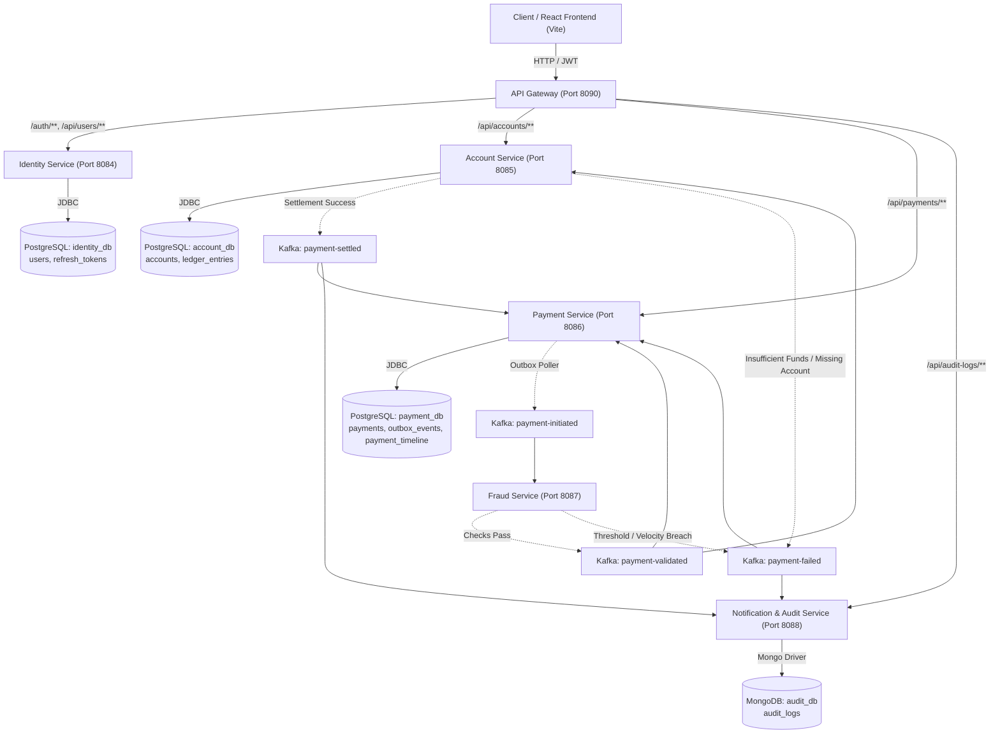
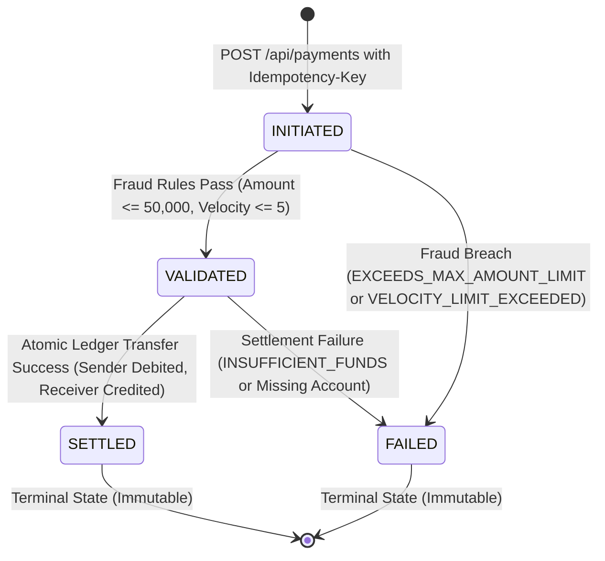

# Software Specification Document (SSD)
## Payment Platform (Mini Banking & Transaction System)

---

## 1. Introduction

### 1.1 Purpose
The purpose of this payment platform is to provide a reliable, event-driven banking transaction system. It handles user accounts, balances, and fund transfers between accounts with high reliability, idempotency, fraud detection, and auditability.

> **DESIGN DECISION**: Build as an event-driven microservices architecture because banking transfers require loose coupling, resilience against service downtime, and decoupled audit/notification workflows.

---

### 1.2 Scope

#### In-Scope
- **Account Management**: Creating accounts and checking account balances.
- **Payment Processing**: Initiating money transfers between accounts.
- **Idempotency Protection**: Preventing duplicate debits or credits when client network requests are retried.
- **Fraud Validation**: Rule-based transaction checks (maximum transaction amount limit and velocity check).
- **Settlement**: Safely updating sender and receiver balances with transaction consistency.
- **Notifications**: Asynchronously notifying users of payment status updates via mock console logs.
- **Audit Logging**: Persisting an append-only, immutable history of all major domain events in MongoDB.
- **Live Status & Dashboard**: A web frontend (React + Redux Toolkit) allowing users to submit payments, view transaction histories, and track payment lifecycle status in real time.
- **API Gateway & Auth**: Routing incoming requests and verifying stateless JWT tokens.

#### Out-of-Scope
- Direct integration with real-world payment rails (such as UPI, SWIFT, FedNow, Visa/Mastercard, or Stripe).
- Real third-party SMS or email delivery providers (e.g., Twilio, SendGrid).
- Multi-currency conversions and foreign exchange (FX) rates (single currency only).
- Advanced banking products (loans, credit limits, interest calculation, fixed deposits, or physical cards/ATMs).
- Full legal KYC/AML identity document verification pipelines.

> **DESIGN DECISION**: Keep external banking rails and third-party telecom APIs out-of-scope because this is an educational platform focused on mastering distributed systems patterns (Saga, Outbox, Idempotency) without third-party vendor complexity or operational costs.

---

### 1.3 Future Scope
- Multi-currency support and real-time FX rate conversion engine.
- Simulator for external clearinghouse settlement (e.g., ISO 20022 message simulator).
- Machine-learning-based anomaly detection for fraud scoring.
- Webhook subscriptions for external merchant callbacks.

---

### 1.4 Glossary

- **Idempotency**: An operation property where executing the action multiple times produces the exact same result as executing it once. In payments, if a user taps "Pay" twice or a network timeout causes a retry, the system debits the account only once.
  - *Real-life Analogy*: An elevator call button. Pressing it 10 times does not call 10 elevators; it registers the request only once.

- **Saga Pattern**: An architectural pattern that coordinates distributed transactions across multiple microservices through a sequence of local transactions and compensating actions (rollbacks) if any step fails.
  - *Real-life Analogy*: Booking a vacation package (Flight + Hotel + Cab). If hotel booking fails, the system automatically cancels the flight and cab so you are not left stranded with a half-booked trip.

- **Outbox Pattern**: A technique where database changes and their corresponding outgoing events are saved in the same local database transaction before being published to Kafka. This guarantees that events are never lost even if the message broker is temporarily down.
  - *Real-life Analogy*: Writing a letter and saving it in your office "Outbox" tray while noting it in your register. Even if the mail courier arrives late, the letter is safely recorded and ready to be delivered.

- **Aggregate**: In Domain-Driven Design (DDD), a cluster of related entity and value objects treated as a single unit for data changes, enforced by an Aggregate Root.
  - *Real-life Analogy*: A physical bank account passbook. You cannot directly scribble a balance change; all deposits or withdrawals must pass through the bank teller (Aggregate Root) who enforces the account rules.

- **Bounded Context**: A clear boundary in Domain-Driven Design where a specific domain model and its terms apply uniformly.
  - *Real-life Analogy*: The word "Customer" means "Account holder with a balance" to the Accounts desk, but "Risk rating and IP address" to the Fraud desk. Each desk operates in its own Bounded Context.

- **Event**: An immutable record of an action that has already occurred in the system (e.g., `PaymentInitiated`, `PaymentSettled`).
  - *Real-life Analogy*: A printed receipt from an ATM. Once printed, you cannot alter the fact that the transaction happened.

- **Topic**: A categorized stream in Apache Kafka where events are published and stored in order.
  - *Real-life Analogy*: A specific newspaper section (e.g., "Business" or "Sports"). Writers publish articles to it, and readers subscribe to that section.

- **Consumer Group**: A collection of Kafka consumers working together to read messages from a topic, where each partition is assigned to only one consumer in the group.
  - *Real-life Analogy*: A team of bank tellers sharing a single line of customers. Each customer is handled by only one teller so work is balanced and no customer is served twice.

- **JWT (JSON Web Token)**: A compact, cryptographically signed token containing claims about a user identity, allowing services to verify identity without querying a database on every request.
  - *Real-life Analogy*: A wristband stamped at an amusement park entrance. Ride operators just check the wristband stamp instead of calling the ticket office every time you enter a ride.

> **DESIGN DECISION**: Explicitly define domain and distributed systems terms up front because clear terminology ensures the team and codebase speak the same ubiquitous language throughout development.

---

## 2. Functional Requirements

### 2.1 Core Monetary & Invariant Rules
Every service and operation handling money in this platform must adhere to the following non-negotiable financial invariants:
1. **Precision Rule**: All monetary values must use `BigDecimal` with a fixed scale of 2 decimal places and `RoundingMode.HALF_EVEN` (banker's rounding). Floating point numbers (`float`, `double`) are strictly forbidden.
2. **Positive Amount Rule**: All transaction and transfer amounts must be strictly greater than zero (`amount > 0.00`). Zero or negative transfers are rejected immediately.
3. **Distinct Parties Rule**: The sender account and receiver account must be different (`senderAccountId != receiverAccountId`). Self-transfers are rejected.
4. **Non-Negative Balance Rule**: An account balance can never drop below zero (`balance >= 0.00`). No overdraft is permitted.

> **DESIGN DECISION**: Use `BigDecimal` instead of `double`/`float` because floating-point arithmetic causes IEEE-754 binary precision inaccuracies (e.g. `0.1 + 0.2 = 0.30000000000000004`), which lead to compounding financial discrepancies in banking ledgers.

> **DESIGN DECISION**: Disallow sender == receiver and enforce amount > 0 at both API Gateway and domain entity levels because zero or self-transfers pollute ledger data and waste system resources without moving actual value.

---

### 2.2 Account Service

*Why this matters in a real payment company*: A bank cannot operate without ledger accounts and strict balance controls that guarantee customer deposits are accurately tracked and never overdrawn.

#### FR-1: Create Account
- **Specification**: The system shall allow creating a new customer account with an initial non-negative balance and a designated currency (default: `INR`).
- **Acceptance Criteria**:
  - **Given** a valid customer ID, currency `INR`, and initial balance >= 0,
  - **When** a `POST /api/accounts` request is received,
  - **Then** a new account is persisted with a unique UUID `accountId`, status `ACTIVE`, specified initial balance, and HTTP 201 Created is returned with the account details.
  - **Given** an initial balance < 0,
  - **When** a `POST /api/accounts` request is received,
  - **Then** the request is rejected with HTTP 400 Bad Request and error code `INVALID_INITIAL_BALANCE`.

#### FR-2: Check Account Balance
- **Specification**: The system shall retrieve the current balance and status of an account by its unique account ID.
- **Acceptance Criteria**:
  - **Given** an existing active account ID,
  - **When** a `GET /api/accounts/{accountId}` request is received,
  - **Then** the system returns HTTP 200 OK containing `accountId`, `status`, `currency`, and `currentBalance`.
  - **Given** an account ID that does not exist,
  - **When** a `GET /api/accounts/{accountId}` request is received,
  - **Then** the system returns HTTP 404 Not Found with error code `ACCOUNT_NOT_FOUND`.

#### FR-3: Reserve / Debit Funds
- **Specification**: The system shall debit funds from an account only if the account is `ACTIVE` and has sufficient available balance (`balance >= amount`).
- **Acceptance Criteria**:
  - **Given** an account with status `ACTIVE` and balance 1,000.00,
  - **When** a debit of 400.00 is requested,
  - **Then** the balance is atomically decremented to 600.00 and success is returned.
  - **Given** an account with balance 1,000.00,
  - **When** a debit of 1,500.00 is requested,
  - **Then** the debit is rejected with error code `INSUFFICIENT_FUNDS` and the balance remains 1,000.00.

#### FR-4: Credit Funds
- **Specification**: The system shall credit funds to a receiver's account only if the account is `ACTIVE`.
- **Acceptance Criteria**:
  - **Given** an active account with balance 500.00,
  - **When** a credit of 400.00 is requested,
  - **Then** the balance is atomically incremented to 900.00 and success is returned.

---

### 2.3 Payment Service

*Why this matters in a real payment company*: The payment service is the central transaction coordinator. It ensures transfers are created once, tracked accurately through their lifecycle, and protected against duplicate charges.

#### FR-5: Initiate Payment with Idempotency Key
- **Specification**: The system shall accept payment requests containing an `Idempotency-Key` header, validate request parameters, persist the payment in `INITIATED` status, and return the same existing record without secondary execution if the same key is reused.
- **Acceptance Criteria**:
  - **Given** a valid transfer request with a new `Idempotency-Key: "key-123"`, valid sender ID, receiver ID (`sender != receiver`), and amount > 0,
  - **When** `POST /api/payments` is received,
  - **Then** a new payment record is saved with status `INITIATED`, linked to `key-123`, and HTTP 202 Accepted is returned with payment ID.
  - **Given** an existing payment previously initiated with `Idempotency-Key: "key-123"` and identical payload,
  - **When** `POST /api/payments` is received again with `Idempotency-Key: "key-123"`,
  - **Then** the system creates no new payment, initiates no second debit, and returns HTTP 200 OK with the existing payment record and current status.
  - **Given** an existing payment previously initiated with `Idempotency-Key: "key-123"` for amount 500.00,
  - **When** `POST /api/payments` is received with `Idempotency-Key: "key-123"` but amount 1,000.00 (payload mismatch),
  - **Then** the system rejects the request with HTTP 409 Conflict (or HTTP 400) and error code `IDEMPOTENCY_PAYLOAD_MISMATCH`.

#### FR-6: Payment Lifecycle & State Machine Transitions
- **Specification**: The system shall enforce a strict state machine:
  - Allowed forward transitions:
    - `INITIATED` -> `VALIDATED` (when fraud checks pass)
    - `INITIATED` -> `FAILED` (when fraud check fails or debit fails)
    - `VALIDATED` -> `SETTLED` (when both debit and credit complete successfully)
    - `VALIDATED` -> `FAILED` (when settlement balance deduction fails or compensation triggers)
  - Disallowed transitions: Any transition from terminal states (`SETTLED`, `FAILED`) to any other state is strictly prohibited (e.g., `SETTLED` -> `INITIATED` or `FAILED` -> `SETTLED`).
  - Only the **Payment Service** is authorized to update payment status.
- **Acceptance Criteria**:
  - **Given** a payment in `SETTLED` status,
  - **When** an event or service attempts to update its status to `INITIATED` or `FAILED`,
  - **Then** the transition is rejected with `INVALID_STATE_TRANSITION` and the status remains `SETTLED`.

#### FR-7: Payment Failure Recording
- **Specification**: When a payment fails at any point in the workflow, the system shall record the exact failure reason and transition to `FAILED`.
- **Acceptance Criteria**:
  - **Given** a payment in `INITIATED` or `VALIDATED` status,
  - **When** a failure occurs (e.g., fraud rejection or insufficient funds),
  - **Then** the payment status is updated to `FAILED`, the `failureReason` field is populated with the specific error code, and a `PaymentFailed` event is published.

> **DESIGN DECISION**: Enforce strict state machine transitions where only Payment Service can mutate payment status because decentralized status mutations lead to race conditions, partial updates, and inconsistent ledger states across microservices.

---

### 2.4 Fraud Service

*Why this matters in a real payment company*: Fraud checks act as an automated security shield, stopping stolen credentials, rogue automated bots, and high-risk drain attempts before money leaves the bank.

#### FR-8: Maximum Amount Limit Check
- **Specification**: The system shall evaluate payment amounts against a configurable maximum single transfer limit (Default: ₹50,000.00).
- **Acceptance Criteria**:
  - **Given** the configured limit is ₹50,000.00,
  - **When** a payment of ₹50,000.00 is evaluated,
  - **Then** the fraud rule passes.
  - **Given** the configured limit is ₹50,000.00,
  - **When** a payment of ₹50,001.00 is evaluated,
  - **Then** the fraud check fails with reason `EXCEEDS_MAX_AMOUNT_LIMIT`.

#### FR-9: Transfer Velocity Check
- **Specification**: The system shall evaluate the number of transfers attempted by a sender account within a sliding 1-minute window against a configurable limit (Default: 5 transfers per minute).
- **Acceptance Criteria**:
  - **Given** a sender account has made 4 transfers in the previous 60 seconds,
  - **When** a 5th transfer is evaluated,
  - **Then** the velocity check passes.
  - **Given** a sender account has made 5 transfers in the previous 60 seconds,
  - **When** a 6th transfer is evaluated within the same window,
  - **Then** the fraud check fails with reason `VELOCITY_LIMIT_EXCEEDED`.

> **DESIGN DECISION**: Make fraud limits configurable via external configuration properties (`application.yml` or environment variables) rather than hardcoded constants because risk thresholds change dynamically according to compliance policies without requiring source code rebuilds.

---

### 2.5 Settlement

*Why this matters in a real payment company*: Settlement is the moment of truth where money actually moves from sender to receiver. It must guarantee that money is neither created from thin air nor destroyed.

#### FR-10: Coordinated Settlement Execution
- **Specification**: The system shall execute settlement only after a payment has successfully reached `VALIDATED` status. It shall debit the sender account and credit the receiver account.
- **Acceptance Criteria**:
  - **Given** a payment with status `VALIDATED`,
  - **When** settlement executes,
  - **Then** the sender account is debited by the payment amount, the receiver account is credited by the payment amount, the payment transitions to `SETTLED`, and a `PaymentSettled` event is published.

#### FR-11: Settlement Failure & Compensation
- **Specification**: If sender debit succeeds but receiver credit cannot complete (e.g. receiver account blocked or suspended), the system shall trigger a compensation action to refund the sender account.
- **Acceptance Criteria**:
  - **Given** sender account was debited 500.00,
  - **When** receiver credit fails,
  - **Then** a compensating credit of 500.00 is executed on the sender account, the payment transitions to `FAILED` with reason `RECEIVER_CREDIT_FAILED_REFUNDED`, and a `PaymentFailed` event is published.

> **DESIGN DECISION**: Implement atomic debit/credit coordination with compensating reversal because distributed two-phase commit (2PC) locks resources and degrades availability across autonomous microservices.

---

### 2.6 Notification Service

*Why this matters in a real payment company*: Customers expect instant alerts on financial activity to confirm their transaction succeeded or immediately notice unauthorized account activity.

#### FR-12: Asynchronous Event-Driven Notifications
- **Specification**: The system shall consume payment status events (`PaymentSettled`, `PaymentFailed`) from Kafka and output mock notification messages to console logs (simulating Email/SMS delivery).
- **Acceptance Criteria**:
  - **Given** a `PaymentSettled` event on Kafka topic `payment-events`,
  - **When** consumed by the Notification Service,
  - **Then** a log is output: `[NOTIFICATION] [SMS/EMAIL] Transfer of {amount} from Account {senderId} to Account {receiverId} completed successfully. Payment ID: {paymentId}`.
  - **Given** a `PaymentFailed` event on Kafka topic `payment-events`,
  - **When** consumed by the Notification Service,
  - **Then** a log is output: `[NOTIFICATION] [SMS/EMAIL] Transfer of {amount} failed. Reason: {failureReason}. Payment ID: {paymentId}`.

> **DESIGN DECISION**: Run notification delivery asynchronously via Kafka consumer rather than synchronously in the payment HTTP request path because slow or failing notification systems should never block or delay money settlement.

---

### 2.7 Audit Logging Service

*Why this matters in a real payment company*: Financial regulators (e.g., RBI, SEC, Federal Reserve) require a permanent, unalterable ledger trail of every single state change and financial event for legal accountability.

#### FR-13: Centralized Immutable Audit Trail
- **Specification**: The system shall consume all domain events from Kafka and persist them as immutable, append-only documents in MongoDB.
- **Acceptance Criteria**:
  - **Given** any domain event published on Kafka (`AccountCreated`, `PaymentInitiated`, `PaymentValidated`, `PaymentSettled`, `PaymentFailed`),
  - **When** consumed by the Audit Service,
  - **Then** an audit document is inserted into MongoDB with `eventId`, `eventType`, `aggregateId`, `timestamp`, `payload`, and `correlationId`.
  - **Given** an existing audit document in MongoDB,
  - **When** an update or delete operation is attempted,
  - **Then** the operation is rejected (append-only enforcement; no update/delete APIs exposed).

> **DESIGN DECISION**: Store audit logs in MongoDB as append-only documents because document databases naturally store arbitrary JSON event payloads without rigid schema migrations, and immutable append-only storage satisfies regulatory compliance.

---

### 2.8 API Gateway & Authentication

*Why this matters in a real payment company*: The API Gateway is the bank's frontline security guard. It inspects all incoming internet traffic, validates security badges (JWTs), and shields internal microservices from direct public exposure.

#### FR-14: Stateless JWT Authentication & Request Routing
- **Specification**: The API Gateway shall validate incoming Bearer JWT tokens on protected endpoints (`/api/accounts/**`, `/api/payments/**`), extract verified identity claims, forward the request with an `X-User-Id` header, and route traffic to the appropriate microservice.
- **Acceptance Criteria**:
  - **Given** an HTTP request with a valid, signed JWT in the `Authorization: Bearer <token>` header,
  - **When** received at the API Gateway,
  - **Then** the gateway verifies token signature and expiration, extracts user ID, injects header `X-User-Id`, and routes request to the target microservice.
  - **Given** an HTTP request with a missing, expired, or tampered JWT,
  - **When** received at the API Gateway,
  - **Then** the gateway rejects the request with HTTP 401 Unauthorized without forwarding traffic downstream.

> **DESIGN DECISION**: Terminate and verify JWTs at the API Gateway so individual downstream microservices do not need to duplicate cryptographic token validation or manage user authentication logic.

---

### 2.9 Frontend Dashboard

*Why this matters in a real payment company*: A bank's customers and operations staff need an intuitive, transparent interface to initiate transfers, review balances, and monitor live status without confusion.

#### FR-15: Payment Initiation Form & Double-Click Prevention
- **Specification**: The frontend shall provide a payment submission form that enforces client-side validation (amount > 0, sender != receiver), generates a unique UUID `Idempotency-Key` per transfer attempt, and disables the submit button during submission.
- **Acceptance Criteria**:
  - **Given** the payment transfer form,
  - **When** the user clicks "Send Payment",
  - **Then** a unique UUID v4 `Idempotency-Key` is generated, the submit button is disabled with a loading spinner, and the `POST /api/payments` request is sent with the header.

#### FR-16: Live Status & Transaction History Display
- **Specification**: The frontend shall display account details, current balance, recent transaction history, and real-time status badges (`INITIATED`, `VALIDATED`, `SETTLED`, `FAILED`).
- **Acceptance Criteria**:
  - **Given** a user viewing the transaction dashboard,
  - **When** a payment lifecycle event is completed in the backend,
  - **Then** the UI reflects the updated payment status badge and refreshed account balances.

---

### 2.11 Identity & Access Management Service (identity-service)

*Why this matters in a real payment company*: Identity is the bedrock of banking trust. A robust identity service guarantees that only verified individuals access their financial funds, enforces role separation between standard customers and administrative personnel, and guards against credential brute-forcing.

#### FR-17: User Registration & Password Policy
- **Specification**: The system shall allow new customers to register with username, email, full name, and a strong password. The registration endpoint exclusively creates accounts with the `USER` role. Passwords must be hashed using BCrypt (work factor 12) before persistence.
- **Acceptance Criteria**:
  - **Given** a registration request with username "rahul", email "rahul@apexpay.demo", full name "Rahul Sharma", and password meeting policy (min 8 characters, at least one uppercase letter, one lowercase letter, and one digit),
  - **When** `POST /auth/register` is received,
  - **Then** the user is created with status `ACTIVE`, role `USER`, failed login attempts initialized to 0, password securely hashed with BCrypt (strength 12), and HTTP 201 Created is returned.
  - **Given** a password failing policy (e.g. "pass", less than 8 chars or missing uppercase/digit),
  - **When** `POST /auth/register` is received,
  - **Then** the request is rejected with HTTP 400 Bad Request and error code `VALIDATION_FAILED`.
  - **Given** an existing username or email,
  - **When** `POST /auth/register` is received,
  - **Then** the request is rejected with HTTP 409 Conflict and error code `USER_ALREADY_EXISTS`.

#### FR-18: Authentication & Dual-Token Issuance
- **Specification**: The system shall authenticate users using username/password credentials and issue a short-lived access JWT (15 minutes validity) along with a long-lived refresh token (7 days validity). Failed attempts return generic error messages to prevent username enumeration.
- **Acceptance Criteria**:
  - **Given** valid credentials for an `ACTIVE` user,
  - **When** `POST /auth/login` is received,
  - **Then** `failed_login_attempts` is reset to 0, `last_login_at` is updated, an HMAC-SHA256 access JWT (claims: `sub`=userId, `username`, `role`) and a secure random refresh token (stored hashed) are generated and returned with HTTP 200 OK.
  - **Given** invalid password or non-existent username,
  - **When** `POST /auth/login` is received,
  - **Then** the request is rejected with HTTP 401 Unauthorized and generic message `INVALID_CREDENTIALS` without disclosing whether the username exists.

#### FR-19: Refresh Token Rotation & Session Revocation
- **Specification**: The system shall support token renewal via refresh tokens. Every refresh operation must rotate the refresh token (issue a new refresh token and invalidate the old one). Logging out revokes the active refresh token.
- **Acceptance Criteria**:
  - **Given** an active, unexpired, non-revoked refresh token,
  - **When** `POST /auth/refresh` is received,
  - **Then** the existing refresh token is marked revoked, a new access JWT and new refresh token are returned with HTTP 200 OK.
  - **Given** an expired, revoked, or non-matching refresh token,
  - **When** `POST /auth/refresh` is received,
  - **Then** the request is rejected with HTTP 401 Unauthorized and error code `INVALID_REFRESH_TOKEN`.
  - **Given** an authenticated user session,
  - **When** `POST /auth/logout` is received with the refresh token,
  - **Then** the refresh token is marked revoked and HTTP 200 OK is returned.

#### FR-20: Failed Login Tracking & Account Lockout
- **Specification**: The system shall track consecutive failed login attempts and automatically transition user status to `LOCKED` upon 5 consecutive failures. Only an administrator can unlock a locked account.
- **Acceptance Criteria**:
  - **Given** an `ACTIVE` user with 4 prior failed login attempts,
  - **When** a 5th incorrect password attempt is submitted,
  - **Then** `failed_login_attempts` increments to 5, user status transitions to `LOCKED`, and the request returns HTTP 401 Unauthorized with error code `ACCOUNT_LOCKED`.
  - **Given** a `LOCKED` user attempting login with correct credentials,
  - **When** `POST /auth/login` is received,
  - **Then** login is denied with HTTP 403 Forbidden and error code `ACCOUNT_LOCKED`.
  - **Given** an administrator (`ADMIN` role),
  - **When** `PATCH /api/users/{id}/status` is received with `{ "status": "ACTIVE" }`,
  - **Then** the user status is updated to `ACTIVE`, `failed_login_attempts` is reset to 0, and HTTP 200 OK is returned.

#### FR-21: Role-Based Access Control (RBAC) & Resource Ownership
- **Specification**: The system shall enforce resource ownership and role-based permissions across all microservices:
  - Standard `USER`: Can only create/view accounts owned by their `X-User-Id`, initiate transfers strictly FROM accounts they own, and view only their own payments and ledger entries.
  - `ADMIN`: Can inspect all accounts, payments, ledger statements, audit logs, and user records. Admins CANNOT initiate payments from user accounts (no impersonation spending).
  - Any unauthorized cross-user access returns HTTP 403 Forbidden with error code `FORBIDDEN`.
- **Acceptance Criteria**:
  - **Given** a user with ID `user-1`,
  - **When** attempting to fetch `GET /api/accounts/{id}` where the account is owned by `user-2`,
  - **Then** the service rejects the request with HTTP 403 Forbidden and error code `FORBIDDEN`.
  - **Given** a user with ID `user-1`,
  - **When** attempting to initiate a payment where `senderAccountId` belongs to `user-2`,
  - **Then** the service rejects the transfer with HTTP 403 Forbidden and error code `FORBIDDEN`.
  - **Given** an `ADMIN` user,
  - **When** attempting to initiate a payment transfer,
  - **Then** the service rejects the transfer with HTTP 403 Forbidden and error code `FORBIDDEN` (admins cannot spend user funds).

---

### 2.12 Out of Scope for Section 2
- Scheduled or recurring payments (standing instructions).
- Partial refunds and dispute/chargeback workflows.
- International wire transfers and currency conversion.
- Overdraft protection and credit lending limits.
- Bulk batch payroll processing.

---

## 3. Non-Functional Requirements (NFR)

1. **Precision & Consistency**:
   - Zero floating-point rounding errors in monetary calculation (`BigDecimal` scale 2, `RoundingMode.HALF_EVEN`).
   - Strong transactional consistency within microservice boundaries; eventual consistency across services via Kafka event choreography.
   - Optimistic concurrency control on accounts (`@Version`) preventing double-debits in concurrent execution.
2. **Idempotency & Deduplication**:
   - Every payment initiation strictly requires a UUID `Idempotency-Key`. Replays return the cached result with zero side-effects.
   - Idempotency key payload mismatch returns HTTP 409 Conflict.
   - Consumers feature deduplication guards (`processedPayments`) preventing double processing of retransmitted Kafka messages.
3. **Resilience & Reliability**:
   - Transactional Outbox Pattern ensures zero event loss even during broker disconnects.
   - Kafka consumer error handling with `DeadLetterPublishingRecoverer` (2 retries with 1s backoff before forwarding to `<topic>.DLT`).
4. **Observability & Traceability**:
   - Distributed correlation ID (`X-Correlation-Id`) generated at the Gateway or HTTP client, propagated through HTTP headers, MDC logging, and Kafka message headers.
   - Centralized immutable append-only audit logging in MongoDB.
5. **Security & Isolation**:
   - Database-per-service pattern (PostgreSQL `account_db`, `payment_db`, `identity_db`, MongoDB `audit_db`). No cross-service database access.
   - Stateless HMAC-SHA256 JWT authentication at the API Gateway with downstream role and user identity propagation (`X-User-Id`, `X-User-Role`, `X-User-Name`).
   - BCrypt password hashing with strength 12.
   - Dual-token lifecycle: Short-lived access JWT (15m) and single-use refresh token (7d) rotation.
   - Gateway rate limiting on `/auth/login` to prevent credential brute-forcing.
   - Zero hardcoded secrets in source code; externalized via environment variables.

---

## 4. Architecture



---

## 5. Data Model

### 5.1 `account_db` (PostgreSQL)

#### `accounts`
| Column | Type | Constraints | Description |
|---|---|---|---|
| `id` | `UUID` | PRIMARY KEY | Unique account identifier |
| `owner_user_id` | `UUID` | NULLABLE, INDEX | User ID from identity-service (RBAC owner) |
| `owner_name` | `VARCHAR(255)` | NOT NULL | Customer name |
| `balance` | `NUMERIC(19, 2)` | NOT NULL | Current available balance |
| `version` | `BIGINT` | NOT NULL DEFAULT 0 | Optimistic locking token |
| `currency` | `VARCHAR(10)` | NOT NULL DEFAULT 'INR' | ISO currency code |
| `status` | `VARCHAR(50)` | NOT NULL DEFAULT 'ACTIVE' | Account state (ACTIVE, BLOCKED) |
| `created_at` | `TIMESTAMPTZ` | NOT NULL | Account opening timestamp |

#### `ledger_entries`
| Column | Type | Constraints | Description |
|---|---|---|---|
| `id` | `UUID` | PRIMARY KEY | Ledger entry UUID |
| `account_id` | `UUID` | NOT NULL, FK -> accounts(id) | Associated account |
| `entry_type` | `VARCHAR(20)` | NOT NULL | `DEBIT` or `CREDIT` |
| `amount` | `NUMERIC(19, 2)` | NOT NULL | Transaction magnitude |
| `balance_after` | `NUMERIC(19, 2)` | NOT NULL | Running balance after transaction |
| `reference_id` | `VARCHAR(100)` | NULLABLE | Associated payment ID or source |
| `description` | `VARCHAR(255)` | NULLABLE | Human-readable explanation |
| `created_at` | `TIMESTAMPTZ` | NOT NULL | Timestamp of ledger posting |

---

### 5.2 `payment_db` (PostgreSQL)

#### `payments`
| Column | Type | Constraints | Description |
|---|---|---|---|
| `id` | `UUID` | PRIMARY KEY | Payment transaction UUID |
| `idempotency_key` | `VARCHAR(255)` | NOT NULL UNIQUE | Unique client deduplication token |
| `sender_account_id` | `UUID` | NOT NULL | Debited account |
| `receiver_account_id` | `UUID` | NOT NULL | Credited account |
| `amount` | `NUMERIC(19, 2)` | NOT NULL | Transfer amount |
| `currency` | `VARCHAR(10)` | NOT NULL DEFAULT 'INR' | Currency code |
| `status` | `VARCHAR(50)` | NOT NULL | `INITIATED`, `VALIDATED`, `SETTLED`, `FAILED` |
| `failure_reason` | `VARCHAR(255)` | NULLABLE | Reason string if terminal state is FAILED |
| `version` | `BIGINT` | NOT NULL DEFAULT 0 | Optimistic lock token |
| `created_at` | `TIMESTAMPTZ` | NOT NULL | Creation timestamp |
| `updated_at` | `TIMESTAMPTZ` | NOT NULL | Last update timestamp |

#### `outbox_events`
| Column | Type | Constraints | Description |
|---|---|---|---|
| `id` | `UUID` | PRIMARY KEY | Event UUID |
| `aggregate_type` | `VARCHAR(255)` | NOT NULL | Aggregate name (`PAYMENT`) |
| `aggregate_id` | `UUID` | NOT NULL | Aggregate ID |
| `event_type` | `VARCHAR(255)` | NOT NULL | Event name (`PaymentInitiated`) |
| `payload` | `TEXT` | NOT NULL | Serialized JSON event string |
| `status` | `VARCHAR(50)` | NOT NULL | `PENDING`, `SENT` |
| `created_at` | `TIMESTAMPTZ` | NOT NULL | Creation timestamp |
| `sent_at` | `TIMESTAMPTZ` | NULLABLE | Timestamp when published to Kafka |

#### `payment_timeline`
| Column | Type | Constraints | Description |
|---|---|---|---|
| `id` | `UUID` | PRIMARY KEY | Timeline entry UUID |
| `payment_id` | `UUID` | NOT NULL, FK -> payments(id) | Associated payment |
| `status` | `VARCHAR(50)` | NOT NULL | Status entered |
| `timestamp` | `TIMESTAMPTZ` | NOT NULL | Timestamp when state entered |
| `failure_reason` | `VARCHAR(255)` | NULLABLE | Failure reason if transition was to FAILED |

---

### 5.3 `audit_db` (MongoDB)

#### Collection: `audit_logs`
```json
{
  "_id": "6718d7...",
  "eventId": "e1000000-0000-0000-0000-000000000001",
  "eventType": "PaymentSettled",
  "aggregateId": "p1000000-0000-0000-0000-000000000001",
  "timestamp": "2026-10-24T14:00:00Z",
  "payload": "{\"paymentId\":\"...\",\"amount\":500.00}",
  "correlationId": "c8942b10-6720-4ff6-9bb5-bb2a440c9f12"
}
```

---

### 5.4 `identity_db` (PostgreSQL)

#### `users`
| Column | Type | Constraints | Description |
|---|---|---|---|
| `id` | `UUID` | PRIMARY KEY | Unique user identifier |
| `username` | `VARCHAR(100)` | NOT NULL UNIQUE | Unique login handle |
| `email` | `VARCHAR(255)` | NOT NULL UNIQUE | Verified email address |
| `full_name` | `VARCHAR(255)` | NOT NULL | Customer legal name |
| `password_hash` | `VARCHAR(255)` | NOT NULL | BCrypt hash (cost factor 12) |
| `role` | `VARCHAR(50)` | NOT NULL DEFAULT 'USER' | `USER` or `ADMIN` |
| `status` | `VARCHAR(50)` | NOT NULL DEFAULT 'ACTIVE' | `ACTIVE` or `LOCKED` |
| `failed_login_attempts`| `INT` | NOT NULL DEFAULT 0 | Failed login attempt counter |
| `created_at` | `TIMESTAMPTZ` | NOT NULL | Registration timestamp |
| `last_login_at` | `TIMESTAMPTZ` | NULLABLE | Most recent successful login |

#### `refresh_tokens`
| Column | Type | Constraints | Description |
|---|---|---|---|
| `id` | `UUID` | PRIMARY KEY | Refresh token UUID |
| `user_id` | `UUID` | NOT NULL, FK -> users(id) | Associated user |
| `token_hash` | `VARCHAR(255)` | NOT NULL | SHA-256 hash of refresh token |
| `expires_at` | `TIMESTAMPTZ` | NOT NULL | Expiration timestamp (7 days) |
| `revoked` | `BOOLEAN` | NOT NULL DEFAULT FALSE | Whether token is revoked |
| `created_at` | `TIMESTAMPTZ` | NOT NULL | Issuance timestamp |

---

## 6. API Specification

### 6.1 Authentication & Identity (`/auth` & `/api/users`)

#### `POST /auth/register`
- **Request Body**:
```json
{
  "username": "rahul.sharma",
  "email": "rahul.sharma@apexpay.demo",
  "fullName": "Rahul Sharma",
  "password": "Password123"
}
```
- **Response (201 Created)**:
```json
{
  "id": "u1000000-0000-0000-0000-000000000001",
  "username": "rahul.sharma",
  "email": "rahul.sharma@apexpay.demo",
  "fullName": "Rahul Sharma",
  "role": "USER",
  "status": "ACTIVE",
  "createdAt": "2026-10-24T14:00:00Z"
}
```

#### `POST /auth/login`
- **Request Body**:
```json
{
  "username": "aryan.pandey",
  "password": "Password123"
}
```
- **Response (200 OK)**:
```json
{
  "accessToken": "eyJhbGciOiJIUzI1NiJ9...",
  "tokenType": "Bearer",
  "expiresIn": 900,
  "refreshToken": "rt-7f1a3...",
  "user": {
    "id": "u0000000-0000-0000-0000-000000000001",
    "username": "aryan.pandey",
    "email": "aryan.pandey@apexpay.demo",
    "fullName": "Aryan Pandey",
    "role": "ADMIN"
  }
}
```

#### `POST /auth/refresh`
- **Request Body**:
```json
{
  "refreshToken": "rt-7f1a3..."
}
```
- **Response (200 OK)**:
```json
{
  "accessToken": "eyJhbGciOiJIUzI1NiJ9...",
  "tokenType": "Bearer",
  "expiresIn": 900,
  "refreshToken": "rt-9b2c4..."
}
```

#### `POST /auth/logout`
- **Request Body**:
```json
{
  "refreshToken": "rt-9b2c4..."
}
```
- **Response (200 OK)**: `{"message": "Logged out successfully"}`

#### `GET /api/users/me`
- **Headers**: `Authorization: Bearer <accessToken>`
- **Response (200 OK)**: UserProfileResponse object.

#### `GET /api/users` (ADMIN only)
- **Headers**: `Authorization: Bearer <accessToken>`
- **Response (200 OK)**: List of `UserResponse` objects.

#### `PATCH /api/users/{id}/status` (ADMIN only)
- **Request Body**: `{"status": "ACTIVE"}` or `{"status": "LOCKED"}`
- **Response (200 OK)**: Updated `UserResponse` object.

---

### 6.2 Accounts API (`/api/accounts`)

#### `POST /api/accounts`
- **Request Body**:
```json
{
  "ownerName": "Rahul Sharma",
  "initialBalance": 10000.00,
  "currency": "INR"
}
```
- **Response (201 Created)**:
```json
{
  "id": "a1000000-0000-0000-0000-000000000001",
  "ownerName": "Rahul Sharma",
  "balance": 10000.00,
  "currency": "INR",
  "status": "ACTIVE",
  "createdAt": "2026-10-24T14:00:00Z"
}
```

#### `GET /api/accounts`
- **Response (200 OK)**: Array of `AccountResponse` objects.

#### `GET /api/accounts/{id}`
- **Response (200 OK)**: Single `AccountResponse` object.

#### `GET /api/accounts/{id}/balance`
- **Response (200 OK)**:
```json
{
  "id": "a1000000-0000-0000-0000-000000000001",
  "balance": 10000.00,
  "currency": "INR",
  "status": "ACTIVE"
}
```

#### `GET /api/accounts/{id}/transactions`
- **Response (200 OK)**:
```json
[
  {
    "id": "l1000000-0000-0000-0000-000000000001",
    "accountId": "a1000000-0000-0000-0000-000000000001",
    "entryType": "CREDIT",
    "amount": 10000.00,
    "balanceAfter": 10000.00,
    "referenceId": "INITIAL_DEPOSIT",
    "description": "Initial account opening balance",
    "createdAt": "2026-10-24T14:00:00Z"
  }
]
```

#### `GET /api/accounts/{id}/statement/csv`
- **Response (200 OK, `text/csv`)**:
```csv
TransactionId,AccountId,OwnerName,Timestamp,Type,Amount,BalanceAfter,ReferenceId,Description
l1000...,a1000...,"Rahul Sharma",2026-10-24T14:00:00Z,CREDIT,10000.00,10000.00,"INITIAL_DEPOSIT","Initial account opening balance"
```

---

### 6.3 Payments API (`/api/payments`)

#### `POST /api/payments`
- **Headers**: `Idempotency-Key: <UUID>`
- **Request Body**:
```json
{
  "senderAccountId": "a1000000-0000-0000-0000-000000000001",
  "receiverAccountId": "a2000000-0000-0000-0000-000000000002",
  "amount": 500.00,
  "currency": "INR"
}
```
- **Response (202 Accepted)**:
```json
{
  "id": "p1000000-0000-0000-0000-000000000001",
  "idempotencyKey": "c8942b10-6720-4ff6-9bb5-bb2a440c9f12",
  "senderAccountId": "a1000000-0000-0000-0000-000000000001",
  "receiverAccountId": "a2000000-0000-0000-0000-000000000002",
  "amount": 500.00,
  "currency": "INR",
  "status": "INITIATED",
  "failureReason": null,
  "createdAt": "2026-10-24T14:00:00Z",
  "updatedAt": "2026-10-24T14:00:00Z",
  "timeline": [
    {
      "id": "t100...",
      "paymentId": "p100...",
      "status": "INITIATED",
      "timestamp": "2026-10-24T14:00:00Z",
      "failureReason": null
    }
  ]
}
```

#### `GET /api/payments`
- **Query Params**: `status`, `from`, `to`, `search`, `page`, `size`, `sort`
- **Response (200 OK)**: Paginated `Page<PaymentResponse>` or `List<PaymentResponse>`.

#### `GET /api/payments/{id}/timeline`
- **Response (200 OK)**: Array of `TimelineEntryResponse` entries tracing `INITIATED` -> `VALIDATED` -> `SETTLED`.

---

### 6.4 Audit Logs API (`/api/audit-logs`)

#### `GET /api/audit-logs`
- **Query Params**: `eventType`, `correlationId`, `aggregateId`, `from`, `to`, `page`, `size`
- **Response (200 OK)**:
```json
{
  "content": [
    {
      "id": "audit-1",
      "eventId": "evt-1",
      "eventType": "PaymentSettled",
      "aggregateId": "p100...",
      "timestamp": "2026-10-24T14:00:05Z",
      "payload": "{\"amount\":500.00}",
      "correlationId": "c8942b10-..."
    }
  ],
  "totalElements": 1,
  "totalPages": 1
}
```

---

## 7. Event Catalog

| Topic | Producer | Consumer(s) | Key | Key Fields in Payload |
|---|---|---|---|---|
| `payment-initiated` | `payment-service` | `fraud-service`, `notification-service` | `paymentId` | `paymentId`, `idempotencyKey`, `senderAccountId`, `receiverAccountId`, `amount`, `currency`, `timestamp` |
| `payment-validated` | `fraud-service` | `account-service`, `payment-service`, `notification-service` | `paymentId` | `paymentId`, `senderAccountId`, `receiverAccountId`, `amount`, `currency` |
| `payment-settled` | `account-service` | `payment-service`, `notification-service` | `paymentId` | `paymentId`, `senderAccountId`, `receiverAccountId`, `amount`, `currency` |
| `payment-failed` | `fraud-service`, `account-service` | `payment-service`, `notification-service` | `paymentId` | `paymentId`, `failureReason` |
| `*.DLT` | Any service (recoverer) | Dead-letter monitor | original key | original message with Kafka exception headers |

### Sample Payload: `PaymentInitiatedEvent`
```json
{
  "paymentId": "p1000000-0000-0000-0000-000000000001",
  "idempotencyKey": "demo-key-12345",
  "senderAccountId": "a1000000-0000-0000-0000-000000000001",
  "receiverAccountId": "a2000000-0000-0000-0000-000000000002",
  "amount": 500.00,
  "currency": "INR",
  "createdAt": "2026-10-24T14:00:00Z"
}
```

---

## 8. Payment State Diagram



---

## 9. Error Handling and Edge Cases

### 9.1 Standard Error Format
All services return standardized JSON error representations:
```json
{
  "timestamp": "2026-10-24T14:00:00Z",
  "status": 409,
  "code": "IDEMPOTENCY_PAYLOAD_MISMATCH",
  "errorCode": "IDEMPOTENCY_PAYLOAD_MISMATCH",
  "message": "Idempotency key reused with different payload",
  "path": "/api/payments"
}
```

### 9.2 Error Code Mapping
| HTTP Status | Error Code | Description |
|---|---|---|
| 400 Bad Request | `INVALID_INITIAL_BALANCE` | Account opening with negative initial balance |
| 400 Bad Request | `INVALID_AMOUNT` | Transfer or debit amount &le; 0 |
| 400 Bad Request | `SAME_ACCOUNT_TRANSFER` | Sender and receiver account IDs are identical |
| 400 Bad Request | `VALIDATION_FAILED` | Jakarta Bean Validation constraint violation |
| 401 Unauthorized | `UNAUTHORIZED` | Missing, invalid, or expired JWT token |
| 401 Unauthorized | `INVALID_CREDENTIALS` | Invalid username or password |
| 401 Unauthorized | `INVALID_REFRESH_TOKEN` | Expired, revoked, or invalid refresh token |
| 403 Forbidden | `FORBIDDEN` | Access denied due to RBAC or resource ownership mismatch |
| 403 Forbidden | `ACCOUNT_LOCKED` | Account locked due to repeated failed logins |
| 404 Not Found | `ACCOUNT_NOT_FOUND` | Account ID does not exist in `accounts` table |
| 404 Not Found | `PAYMENT_NOT_FOUND` | Payment ID does not exist in `payments` table |
| 404 Not Found | `USER_NOT_FOUND` | User ID does not exist in `users` table |
| 409 Conflict | `INSUFFICIENT_FUNDS` | Debit requested exceeds current available balance |
| 409 Conflict | `IDEMPOTENCY_PAYLOAD_MISMATCH` | Reused idempotency key with modified transfer parameters |
| 409 Conflict | `INVALID_STATE_TRANSITION` | Attempted mutation of terminal payment (`SETTLED` / `FAILED`) |
| 409 Conflict | `USER_ALREADY_EXISTS` | Registration with already taken username or email |
| 429 Too Many Requests | `RATE_LIMIT_EXCEEDED` | Request rate limit exceeded on authentication endpoints |

### 9.3 Edge Cases & Distributed Guards
- **Broker Downtime**: Payment Service writes both payment record and `OutboxEvent` in one Postgres transaction. Even if Kafka is down, events are polled and published once Kafka restores.
- **Duplicate Messages**: Consumers check local idempotency caches (`processedPayments`) before executing transfers.
- **Poison Pills / Malformed Messages**: Handled by Spring Kafka `DefaultErrorHandler` with `DeadLetterPublishingRecoverer` forwarding to `<topic>.DLT` after 2 retries.

---

## 10. Test Strategy

| Test Type | Scope | Tools Used |
|---|---|---|
| **Unit Tests** | Domain aggregates, business invariant rules, fraud engines, JWT signing | JUnit 5, AssertJ, Mockito |
| **Integration Tests** | REST controllers, Spring MVC mappings, H2 persistence, JSON validation | `@SpringBootTest`, `MockMvc`, `WebTestClient` |
| **Testcontainers Integration Tests** | Real PostgreSQL database constraints, Flyway migrations, Apache Kafka KRaft message exchange | Testcontainers, `PostgreSQLContainer`, `KafkaContainer` |
| **End-to-End Smoke Tests** | Multi-container Docker Compose validation, PowerShell demo execution | `docker-compose.yml`, `DEMO.md` |

---

## 11. Known Limitations & Future Scope

### Known Limitations
1. Single Currency: Currently supports only `INR`.
2. Sliding Window Velocity Cache: In-memory sliding window in `fraud-service` resets on service restart (production should back with Redis).
3. Simulated Clearing: External clearing rails (UPI, IMPS, RTGS) are simulated via internal event choreography.

### Future Scope
1. Redis-backed distributed velocity tracking and rate-limiting.
2. ISO 20022 clearing simulator for international wire transfers.
3. OAuth2 / OpenID Connect single sign-on integration.

---

## 12. Requirements Traceability Matrix

| Functional Requirement | Core Backend Implementation | Test Suite |
|---|---|---|
| **FR-1**: Create Account | `AccountService.createAccount`, `Account.java` | `AccountTest.java`, `AccountControllerIntegrationTest.java` |
| **FR-2**: Check Balance | `AccountService.getBalance`, `AccountController.java` | `AccountControllerIntegrationTest.java` |
| **FR-3**: Debit Funds | `Account.debit`, `AccountService.debit` | `AccountTest.java`, `AccountControllerIntegrationTest.java` |
| **FR-4**: Credit Funds | `Account.credit`, `AccountService.credit` | `AccountTest.java`, `AccountControllerIntegrationTest.java` |
| **FR-5**: Idempotent Payment | `PaymentService.initiatePayment`, `PaymentRepository.java` | `PaymentControllerIntegrationTest.java`, `PaymentIdempotencyTestcontainersTest.java` |
| **FR-6**: State Machine Transitions | `Payment.validate`, `Payment.settle`, `Payment.fail` | `PaymentTest.java`, `PaymentFeaturesIntegrationTest.java` |
| **FR-7**: Failure Reason Recording | `Payment.fail`, `PaymentTimeline.java` | `PaymentTest.java`, `PaymentFeaturesIntegrationTest.java` |
| **FR-8**: Amount Limit Check | `FraudCheckService.checkAmountLimit`, `FraudProperties.java` | `FraudCheckServiceTest.java` |
| **FR-9**: Velocity Check | `FraudCheckService.checkVelocityLimit` | `FraudCheckServiceTest.java` |
| **FR-10**: Settlement Execution | `SettlementEventListener.java`, `AccountService.transfer` | `KafkaFlowTestcontainersTest.java`, `AccountTransactionsIntegrationTest.java` |
| **FR-11**: Settlement Compensation | `SettlementEventListener.publishFailure` | `SettlementEventListenerTest.java` |
| **FR-12**: Notifications | `NotificationEventListener.java` | `NotificationServiceApplicationTests.java` |
| **FR-13**: MongoDB Audit Trail | `AuditEventListener.java`, `AuditLogRepository.java` | `AuditEventListenerTest.java`, `AuditLogControllerTest.java` |
| **FR-14**: Gateway JWT & Routing | `JwtAuthenticationFilter.java`, `JwtUtil.java` | `AuthControllerTest.java`, `JwtUtilTest.java` |
| **FR-15**: Double-Click Form | `PaymentForm.jsx`, `ConfirmationModal.jsx` | `PaymentForm.jsx` |
| **FR-16**: Live Dashboard & Stepper | `TransactionList.jsx`, `StatusStepperModal.jsx`, `SpendingChart.jsx` | `App.jsx`, `TransactionList.jsx` |
| **FR-17**: User Registration | `UserService.register`, `User.java` | `UserServiceTest.java`, `AuthControllerTest.java` |
| **FR-18**: Auth & Dual Token | `AuthService.login`, `JwtTokenProvider.java` | `AuthServiceTest.java`, `AuthControllerTest.java` |
| **FR-19**: Refresh Token Rotation | `AuthService.refreshToken`, `RefreshTokenRepository.java` | `AuthServiceTest.java`, `AuthControllerTest.java` |
| **FR-20**: Failed Login & Lockout | `AuthService.handleFailedLogin`, `User.lock` | `UserServiceTest.java`, `UserControllerTest.java` |
| **FR-21**: RBAC & Ownership | `AccountSecurityEvaluator.java`, `PaymentSecurityEvaluator.java` | `AccountRbacIntegrationTest.java`, `PaymentRbacIntegrationTest.java` |


