# DevSecOps & Security Governance Guide

This document explains the security architecture, local quality scanning, CI/CD pipelines, and verification procedures for the **ApexPay** microservices platform.

---

## 1. DevSecOps Pipeline Flow

```mermaid
flowchart LR
    Dev["Developer Commit"] --> CI["GitLab CI Pipeline"]
    
    subgraph S1 ["1. Build & Test"]
        Build["Maven Multi-Module Compile"] --> Unit["Surefire Unit Tests"]
        Unit --> Int["Failsafe Integration Tests<br/>(Testcontainers DinD)"]
        Int --> JaCoCo["JaCoCo Coverage XML"]
    end
    
    subgraph S2 ["2. Quality & Security"]
        JaCoCo --> Sonar["SonarQube Quality Gate<br/>Coverage >= 70%, 0 Bugs"]
        Sonar --> TrivyFS["Trivy Filesystem & SCA"]
        TrivyFS --> Secret["Trivy Secret Scanner"]
    end
    
    subgraph S3 ["3. Packaging & Container Security"]
        Secret --> Kaniko["Kaniko Container Build<br/>(Temurin 21 Non-Root)"]
        Kaniko --> TrivyImg["Trivy Image Scan<br/>(0 High/Critical CVEs)"]
    end
    
    subgraph S4 ["4. GitOps Deployment"]
        TrivyImg --> Helm["Helm Umbrella Chart"]
        Helm --> Kind["Kubernetes / Kind Cluster"]
    end

    CI --> S1 --> S2 --> S3 --> S4
```



---

## 2. Local SonarQube Setup & Token Creation

We provide a lightweight, dedicated SonarQube Community Edition stack running on PostgreSQL.

### Step 1: Start the SonarQube Container Stack
Run in PowerShell:
```powershell
docker compose -f docker-compose.quality.yml up -d
```
*Note: SonarQube and its PostgreSQL database require ~2 GB of free RAM.*

### Step 2: Generate SonarQube Analysis Token
1. Open your browser and navigate to `http://localhost:9000`.
2. Log in with the default credentials:
   - **Username**: `admin`
   - **Password**: `admin`
3. When prompted, set a new password (e.g. `Admin@ApexPay2026!`).
4. Click your user avatar in the top-right corner -> **My Account** -> **Security** tab.
5. Under **Generate Tokens**:
   - **Name**: `apexpay-local`
   - **Type**: `User Token`
   - **Expires in**: 30 days (or No Expiration)
6. Click **Generate** and copy the generated token string (`squ_...`).

### Step 3: Configure the ApexPay Quality Gate
In SonarQube UI:
1. Navigate to **Quality Gates** -> **Create**.
2. Name: `ApexPay Financial Standards`.
3. Add the following conditions:
   - **Coverage on New Code**: `>= 70.0%`
   - **New Reliability Bugs**: `0`
   - **New Security Vulnerabilities**: `0`
   - **Duplicated Lines on New Code**: `<= 3.0%`
   - **Security Hotspots Reviewed**: `100%`
4. Set `ApexPay Financial Standards` as the Default Quality Gate.

### Step 4: Execute Local Sonar Analysis
Run in PowerShell:
```powershell
$env:SONAR_TOKEN="<your_copied_token>"
.\mvnw.cmd clean verify -B
.\mvnw.cmd sonar:sonar `
  -Dsonar.host.url="http://localhost:9000" `
  -Dsonar.token="$env:SONAR_TOKEN" `
  -Dsonar.qualitygate.wait=true
```

---

## 3. Local Security Scanning with Trivy

Trivy runs free and locally to catch container vulnerabilities, filesystem dependencies, secret leaks, and Kubernetes misconfigurations.

### 1. Filesystem Vulnerability Scan (SCA)
```powershell
trivy fs --scanners vuln --severity HIGH,CRITICAL --ignorefile .trivyignore .
```

### 2. Secret Leak Detection
Guards against hardcoded API keys, JWT secrets, database passwords, or private keys:
```powershell
trivy fs --scanners secret .
```

### 3. Infrastructure-as-Code (IaC) & Helm Audit
Audits Kubernetes manifests and Helm charts against CIS benchmarks:
```powershell
trivy config deploy/
```

### 4. Container Image Vulnerability Scan
```powershell
trivy image apexpay/payment-service:latest
```

---

## 4. API Gateway Security Guardrails

The Spring Cloud API Gateway (Port 8090) enforces defence-in-depth:
1. **Defensive HTTP Headers**:
   - `X-Content-Type-Options: nosniff`
   - `X-Frame-Options: DENY`
   - `X-XSS-Protection: 1; mode=block`
   - `Referrer-Policy: strict-origin-when-cross-origin`
2. **CORS Restrictions**:
   - Cross-origin requests are blocked unless originating from allowed origins declared in `$CORS_ALLOWED_ORIGINS` (default: `http://localhost:5173,http://localhost:3000,http://localhost`).
3. **Brute-Force Rate Limiting**:
   - `LoginRateLimiterFilter` restricts `/auth/login` to a maximum of 15 requests per minute per IP address. Exceeded limits return HTTP 429 `RATE_LIMIT_EXCEEDED`.
4. **Header Sanctification**:
   - The Gateway strips and overrides client-supplied `X-User-Id` and `X-User-Role` headers before forwarding requests downstream, guaranteeing that services only receive cryptographically verified identity claims.

---

## 5. Observability & Logging Access

When the observability stack is launched (`docker compose -f docker-compose.observability.yml up -d`):
- **Grafana**: `http://localhost:3000` (credentials: `admin` / `admin`)
  - Dashboards available under folder `ApexPay`:
    - `ApexPay — Platform Overview` (HTTP traffic, p95 latency, 5xx errors, JVM memory, HikariCP pools)
    - `ApexPay — Payments Business Operations` (Initiated/Settled volumes, success rate, failure reasons, outbox lag, DLT counts)
    - `ApexPay — Kafka and Consumers Dashboard` (Throughput, listener duration, DLT rate)
- **Kibana**: `http://localhost:5601`
  - Pre-created Data View: `apexpay-*`
  - Saved Search: `ApexPay Correlation Tracing and Errors`
- **Prometheus**: `http://localhost:9090`
  - Pre-configured alert rules: `ServiceDown`, `PaymentHighErrorRate`, `OutboxPendingBacklog`, `KafkaDLTDetected`
- **Elasticsearch API**: `http://localhost:9200`

---

## 6. Deploying to Local Kind Cluster

We provide automated PowerShell scripts to spin up, deploy, and verify the platform on a local Kubernetes Kind cluster.

### Step 1: Create Kind Cluster with Ingress
```powershell
.\scripts\kind-up.ps1
```
This script:
1. Provisions a single-node cluster named `apexpay-cluster` with port mappings `80:80` and `443:443`.
2. Installs the official `ingress-nginx` controller for Kind.
3. Loads all locally built microservice container images into the Kind node.

### Step 2: Deploy Helm Umbrella Chart
```powershell
.\scripts\deploy.ps1
```
Deploys `deploy/helm/payment-platform` with `values-dev.yaml` into the `apexpay` namespace.

### Step 3: Run End-to-End Smoke Test
```powershell
.\scripts\smoke-test.ps1
```
Authenticates as Admin Aryan Pandey, verifies `/api/users/me`, switches to user `rahul.sharma`, and initiates an idempotent money transfer.

### Step 4: Teardown
```powershell
.\scripts\kind-down.ps1
```

---

## 7. OpenShift Enterprise Compliance (Restricted SCC)

Enterprise banking environments running Red Hat OpenShift enforce `restricted-v2` Security Context Constraints (SCC). The ApexPay deployment manifests adhere to these guidelines:
1. **Non-Root Execution**: `runAsNonRoot: true` is enforced across all pods.
2. **Arbitrary UID Tolerance**: The Temurin JRE containers run under arbitrary UIDs assigned by OpenShift without requiring fixed root IDs.
3. **Privilege Escalation Prevention**: `allowPrivilegeEscalation: false` with all capabilities dropped (`drop: ["ALL"]`).
4. **Read-Only Root Filesystem**: `readOnlyRootFilesystem: true` with an in-memory `emptyDir` mounted at `/tmp` for temporary JVM writes, preventing container escape attacks.
5. **Zero-Trust Network Isolation**: Kubernetes `NetworkPolicy` objects default-deny all namespace ingress, explicitly whitelisting traffic from Ingress -> Gateway -> Downstream Microservices -> Databases.
